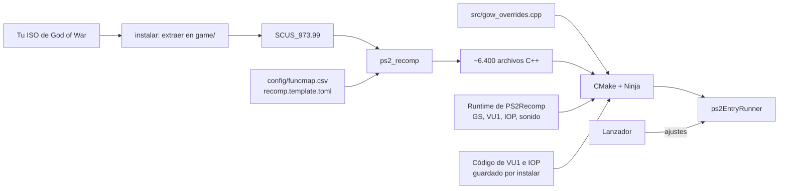

<div align="center">

# God of War — Tobiichi Port

[English](README.md) · [Türkçe](README.tr.md) · **Español**

**Un port nativo para PC de *God of War* (PlayStation 2, NTSC-U `SCUS-97399`) para Linux y Windows.
El código del juego se recompila estáticamente de MIPS a C++; el hardware de la PS2 no se emula, se sustituye por
código nativo.**


</div>

---

> [!IMPORTANT]
> Este repositorio **no contiene archivos del juego** (ISO, ejecutable, módulos IRX, datos `.PAK`) ni código generado a
> partir de ellos. Necesitas **tu propia copia legal** de *God of War* para PS2 (versión de EE. UU., `SCUS-97399`). El
> instalador lo genera todo en tu ordenador a partir de tu imagen del disco; nada derivado del juego sale de él.

## Índice

- [Sobre el nombre](#sobre-el-nombre)
- [Qué es](#qué-es)
- [Características](#características)
- [Requisitos](#requisitos)
- [Instalación en Windows](#instalación-en-windows)
- [Instalación en Linux](#instalación-en-linux)
- [Jugar](#jugar)
- [Rendimiento](#rendimiento)
- [Actualizar](#actualizar)
- [Solución de problemas](#solución-de-problemas)
- [Cómo funciona](#cómo-funciona)
- [Estructura del repositorio](#estructura-del-repositorio)
- [Colaboradores](#colaboradores)
- [Créditos y licencia](#créditos-y-licencia)

## Sobre el nombre

El proyecto toma su nombre de **Origami Tobiichi** (鳶一折紙), personaje del anime y las novelas ligeras
***Date A Live*** (DAL).

## Qué es

En lugar de emular la PlayStation 2 instrucción a instrucción, este proyecto **traduce el ejecutable original del
juego (`SCUS_973.99`) a C++** con [PS2Recomp](https://github.com/ran-j/PS2Recomp) y lo compila como un programa
nativo. Alrededor del código del juego hay un runtime que hace de forma nativa el trabajo del hardware de la PS2:

| Parte de la PS2 | En este port |
|---|---|
| **CPU EE** (código del juego) | Recompilada a C++ (~6.400 funciones) |
| **VU1** (microcódigo de la unidad vectorial) | Compilado por adelantado a C++ a partir del microcódigo que usa el juego |
| **GS** (gráficos) | Renderizador nativo en OpenGL con render targets en la GPU, resolución interna 1×–4× |
| **IOP** (procesador de E/S) | Los módulos IRX del juego, compilados por adelantado a C++ |
| **Sonido, mando, tarjeta de memoria, vídeos** | Servicios nativos: motor de sonido, mando/teclado/ratón, tarjeta `.ps2`, vídeos MPEG-2 (libmpeg2) |

## Características

| | |
|---|---|
| **Lanzador** | Tarjeta gráfica, ventana/pantalla completa, resolución, relación de aspecto, filtro de imagen, resolución interna, límite de cuadros, teclado, trucos — en turco, inglés y español |
| **Panorámico** | Cámara Hor+ real (16:9, 16:10, 21:9) basada en el parche de PCSX2; los vídeos pasan a las versiones panorámicas del propio juego y llenan la pantalla |
| **Imagen** | Bilineal suave o bicúbico con realce ajustable, FXAA opcional |
| **Vídeos** | Todos los vídeos se reproducen de forma nativa, a velocidad real y con su sonido |
| **Aspecto original** | Los iconos de botones de PlayStation y el HUD del propio juego |
| **Teclado y ratón** | Distribución completa y reasignable; cualquier mando funciona también |
| **Fijar objetivo** | **Alt** fija el enemigo más cercano; mover el ratón a izquierda o derecha cambia de objetivo |
| **Combate ágil** | Los ataques y bloqueos salen antes de una voltereta, y una pulsación de ataque perdida se reintenta un momento |
| **Menú de trucos** | **F2** en la partida: inmortalidad, matar de un golpe, magia y Furia de los Dioses infinitas, orbes al máximo, todas las mejoras y poderes, desbloquear todos los extras |
| **FPS en pantalla** | Cuadros del juego y de la ventana en una esquina (opción del lanzador) |

## Requisitos

- **La imagen de tu disco de *God of War* (EE. UU., `SCUS-97399`)** como archivo `.iso` (unos 8 GB). Créala desde tu
  propio disco con cualquier programa de copia de DVD.
- **20 GB libres en disco** (el disco extraído, unos 8 GB, más la compilación).
- **Una CPU x86 de 64 bits** (4 núcleos o más recomendados; en Windows debe tener **AVX2**, como toda CPU Intel desde
  2013 y toda AMD desde 2015) y **8 GB de RAM** (16 GB recomendados al compilar).
- **Una GPU con OpenGL 4.3 o superior**: cualquier tarjeta NVIDIA/AMD o los gráficos integrados de una CPU
  Intel/AMD reciente.
- **Windows 10/11 x64** o una distribución **Linux** (Arch/CachyOS, Ubuntu 24.04+, Fedora 40+ o similar).
- Tiempo: la primera compilación tarda **30–90 minutos** según la CPU. Las actualizaciones solo recompilan lo que
  cambia.

## Instalación en Windows

1. **Descarga el proyecto.** Pulsa **Code → Download ZIP** en GitHub y descomprímelo, o con Git:
   ```bat
   git clone https://github.com/YYOzcan/Tobiichi-Port.git
   ```
   Si puedes, usa una ruta corta y sin caracteres especiales (por ejemplo `C:\Juegos\Tobiichi-Port`).
2. **Copia tu imagen del disco** en la carpeta `game` del proyecto con el nombre `God of War.iso`.
3. **Solo la primera vez — instala las herramientas.** Abre la carpeta del proyecto, escribe `cmd` en la barra de
   direcciones, pulsa Intro y ejecuta:
   ```bat
   instalar.cmd -Herramientas
   ```
   Instala con `winget` Git, Python 3 y Visual Studio 2022 Build Tools (compilador de C++, CMake y Ninja). Windows
   pide permiso de administrador: acéptalo. Tarda 15–30 minutos y después sigue solo con el paso 4.
4. **Compila.** Si las herramientas ya están instaladas, basta con **hacer doble clic en `instalar.cmd`**. El
   instalador:
   1. extrae el disco en `game\` (después ya no hace falta la `.iso`);
   2. compila el recompilador y traduce `SCUS_973.99` a C++;
   3. compila el juego (`ps2EntryRunner.exe`) y el lanzador — si Qt 6 no está instalado, lo descarga solo en
      `herramientas\qt`;
   4. **optimiza**: el juego se abre solo durante 4 minutos y juega el principio del primer nivel con pulsaciones
      automáticas. **No toques el teclado ni el ratón en este paso.** Guarda el microcódigo de VU1 y los módulos del
      IOP que usa el juego y los recompila como código nativo (mucho más rápido);
   5. crea el acceso directo **God Of War - Tobiichi Port** en el escritorio y en el menú Inicio.
5. **Juega** desde el acceso directo. En el lanzador revisa una vez la pestaña **Archivos** (todo debería estar
   detectado) y pulsa **JUGAR**.

Opciones: `instalar.cmd -Iso "D:\ruta\God of War.iso"` usa una imagen de otra carpeta; `-SinOptimizar` omite el paso
4.4; `-Optimizar` lo repite más adelante.

## Instalación en Linux

1. **Instala las dependencias.**
   - **Arch / CachyOS / Manjaro:**
     ```bash
     sudo pacman -S --needed base-devel cmake ninja python git qt6-base qt6-declarative qt6-svg
     ```
   - **Ubuntu / Debian:**
     ```bash
     sudo apt install build-essential cmake ninja-build python3 git libgl-dev libx11-dev libxrandr-dev \
       libxinerama-dev libxcursor-dev libxi-dev libxkbcommon-dev libwayland-dev libasound2-dev qt6-base-dev qt6-declarative-dev \
       qml6-module-qtquick-controls qml6-module-qtquick-layouts qml6-module-qtquick-dialogs \
       qml6-module-qtquick-effects qml6-module-qtquick-shapes qml6-module-qtquick-particles qml6-module-qtcore
     ```
   - **Fedora:**
     ```bash
     sudo dnf install gcc-c++ cmake ninja-build python3 git mesa-libGL-devel libX11-devel libXrandr-devel \
       libXinerama-devel libXcursor-devel libXi-devel libxkbcommon-devel wayland-devel alsa-lib-devel \
       qt6-qtbase-devel qt6-qtdeclarative-devel
     ```
2. **Descarga el proyecto:**
   ```bash
   git clone https://github.com/YYOzcan/Tobiichi-Port.git
   cd Tobiichi-Port
   ```
3. **Copia tu imagen del disco** a `game/God of War.iso` (o pasa su ruta en el siguiente paso).
4. **Ejecuta el instalador:**
   ```bash
   ./instalar.sh                                  # o: ./instalar.sh "/ruta/God of War.iso"
   ```
   Hace lo mismo que en Windows: extrae el disco en `game/`, genera el código C++, compila el juego y el lanzador,
   **optimiza** (el juego se abre solo 4 minutos — no toques el teclado ni el ratón) y añade
   **God Of War: Tobiichi Port** al menú de aplicaciones.
   Opciones: `--sin-optimizar`, `--optimizar [segundos]`, `--jobs N`.
5. **Juega** desde el menú de aplicaciones o con `launcher/build/tobiichi-launcher`. Sin el lanzador: `./run_gow.sh`.

## Jugar

**Teclado y ratón (distribución por defecto, reasignable en el lanzador):**

| Acción | Tecla | Acción | Tecla |
|---|---|---|---|
| Moverse | **W A S D** | Esquivar (stick derecho) | **Ctrl + W A S D** |
| Ataque ligero (□) | **Clic izquierdo** | Ataque fuerte (△) | **Clic derecho** |
| Saltar (✕) | **Espacio** | Agarrar (○) | **F** |
| Bloquear (L1) | **Q** | R1 | **E** |
| L2 / R2 (magia) | **Mayús / Ctrl** | Furia de los Dioses | **V** |
| Magias 1–4 | **1 2 3 4** | Espada de Artemisa (L1 + R1) | **Clic central** |
| Cruceta | **Flechas** | Cámara (stick derecho) | **I J K L** |
| Start / Select | **Intro / Tab** | Fijar objetivo | **Alt** (el ratón cambia de objetivo) |

**Atajos:** **F2** menú de trucos · **F11** pantalla completa · **F1** panel de desarrollo. **Mandos:** DualShock 4,
DualSense, Xbox y otros funcionan directamente (con vibración en Windows).

**Tarjeta de memoria:** las partidas se guardan en `game/Mcd001.ps2` (tarjeta compatible con PCSX2; puedes copiar ahí
la tuya de PCSX2).

## Rendimiento

La lógica del juego va atada al VBlank de 60 Hz de la PS2, así que **el juego nunca pasa de 60 cuadros/s**; el port lo
mantiene a velocidad real (pierde cuadros en lugar de ir a cámara lenta).

- **GPU dedicada (NVIDIA/AMD):** lo normal es 60 cuadros/s con resolución interna 2×–3×.
- **Gráficos integrados** (por ejemplo Radeon 680M): 1×–2×. Medido en el combate de la cubierta del barco a 1×:
  50–60 cuadros/s con el perfil de energía *rendimiento*; con batería o *ahorro de energía* baja el reloj de la CPU y
  con él los cuadros.
- Lo más pesado es el hilo de VU1 (CPU). Repetir la optimización después de jugar zonas nuevas
  (`./instalar.sh --optimizar` / `instalar.cmd -Optimizar`) convierte más de ese trabajo en código nativo.

## Actualizar

```bash
git pull
./instalar.sh          # Windows: instalar.cmd
```
Solo se recompilan los archivos que cambian; el disco extraído y el código de VU1/IOP guardado se conservan.

## Solución de problemas

| Problema | Solución |
|---|---|
| "No encuentro la ISO" | Ponla en `game/God of War.iso` o pasa su ruta al instalador. Solo funciona la versión de EE. UU. (`SCUS-97399`). |
| El juego va lento | Ejecuta la optimización (`--optimizar`); elige resolución interna 1× o 2×; en portátiles usa el perfil de energía *rendimiento*. |
| El lanzador no compiló en Linux | Instala los paquetes de Qt 6 de arriba y vuelve a ejecutar `./instalar.sh`. `./run_gow.sh` juega sin él. |
| Windows: "falta Visual Studio" | Ejecuta `instalar.cmd -Herramientas`. |
| Pantalla negra o cierre en una GPU antigua | El renderizador necesita OpenGL 4.3; actualiza el controlador gráfico. |
| ¿Dónde están los registros? | Lanzador: **Otros → Último registro del juego**. Instalador: `build-gen/` (`recomp.log`, `optimizar.log`). |

## Cómo funciona



Más: [`docs/ULTIMATE.md`](docs/ULTIMATE.md) (esta versión), [`docs/waffle/`](docs/waffle/README.md) (documentación
del runtime de Waffle565, en inglés), [`docs/`](docs/) (registro de la investigación y notas anteriores).

## Estructura del repositorio

```
.
├── instalar.sh / instalar.cmd / instalar.ps1   # instaladores (Linux / Windows)
├── run_gow.sh                                  # jugar sin el lanzador (Linux)
├── game/                                       # aquí va tu disco extraído (git lo ignora)
├── config/                                     # mapa de funciones y configuración del recompilador (con el parche panorámico)
├── src/                                        # reemplazos propios del juego (gow_overrides.cpp)
├── PS2Recomp/                                  # recompilador y runtime (GS, VU1, IOP, sonido, mando, tarjeta de memoria)
├── launcher/                                   # God Of War: Tobiichi Launcher (Qt 6)
├── tools/                                      # generadores de código de VU1/IOP, extractor de ISO, diagnóstico
└── docs/                                       # documentación
```

## Colaboradores

<table>
  <tr>
    <td align="center"><a href="https://github.com/YYOzcan"><br/><b>YYOzcan</b></a><br/>Tobiichi Port: port a Linux, lanzador, panorámico, extras de juego, integración</td>
    <td align="center"><a href="https://github.com/Waffle565"><br/><b>Waffle565</b></a><br/><a href="https://github.com/Waffle565/God-Of-War-Native-Port">God-Of-War-Native-Port</a>: renderizador nativo del GS, IOP y VU1 compilados a C++, vídeos, sonido, tarjeta de memoria</td>
    <td align="center"><a href="https://github.com/KIexster"><br/><b>KIexster</b></a><br/><a href="https://github.com/KIexster/god-of-war-recomp">god-of-war-recomp</a>: la cadena de recompilación de God of War, el compilador de VU1 y las correcciones del runtime en que se basa este port</td>
  </tr>
</table>

## Créditos y licencia

- [**PS2Recomp**](https://github.com/ran-j/PS2Recomp) de ran-j y colaboradores — recompilador y runtime (GPL-3.0).
- [**Fork del runtime de SotC de LightVelox**](https://github.com/LightVelox/PS2Recomp/tree/ac9efa070638ad3b3accd284de6f898d5ab271d1) (Taylor N. Albarnaz) — contexto OpenGL del GS y correcciones del EE (GPL-3.0).
- [**PCSX2**](https://github.com/PCSX2/pcsx2) — referencia para la verificación; intérprete de VU y código de referencia del EE (GPL-3.0+).
- Panorámico basado en el parche "Widescreen 16:9" de PCSX2 para SCUS-97399 de nemesis2000 y CRASHARKI.
- [libmpeg2](https://libmpeg2.sourceforge.io/) (GPL-2.0+), [raylib](https://www.raylib.com/) (zlib), [Dear ImGui](https://github.com/ocornut/imgui) (MIT), [Qt 6](https://www.qt.io/) (LGPL-3.0), fuente [Cinzel](https://github.com/NDISCOVER/Cinzel) (SIL OFL 1.1).
- *God of War* © Sony Interactive Entertainment / Santa Monica Studio. Este proyecto no está afiliado ni respaldado
  por Sony. No se distribuye contenido del juego. *Date A Live* y Origami Tobiichi © Koushi Tachibana / Tsunako /
  KADOKAWA.

El código de este repositorio se publica bajo la **Licencia Pública General de GNU v3.0**, como PS2Recomp. Ver
[`LICENSE`](LICENSE).
