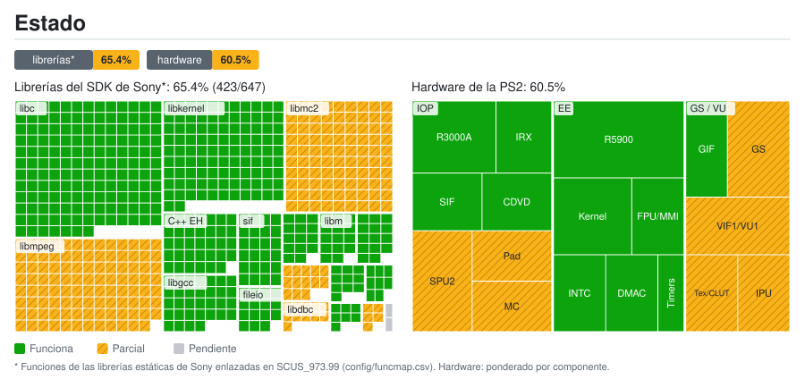
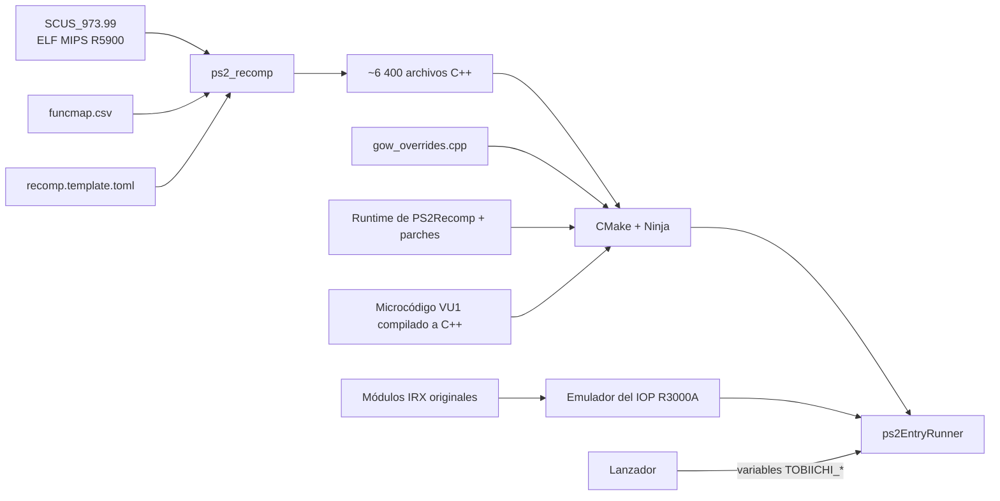

<div align="center">

# God of War — Tobiichi Port

[English](README.md) · [Türkçe](README.tr.md) · **Español**

**Port nativo para PC de *God of War* (PS2, NTSC-U `SCUS-97399`), hecho recompilando estáticamente código MIPS R5900 a C++, con su propio lanzador.**


</div>

---

> [!IMPORTANT]
> Este repositorio **no contiene ningún archivo del juego** (ISO, ejecutable, módulos IRX ni datos `.PAK`) ni el
> código C++ generado a partir de ellos. Necesitas **tu propia copia legal** de God of War para PS2.

## Índice

- [Qué es](#qué-es)
- [Lo más destacado](#lo-más-destacado)
- [Estado actual](#estado-actual)
- [Inicio rápido](#inicio-rápido)
- [God Of War: Tobiichi Launcher](#god-of-war-tobiichi-launcher)
- [Estructura del repositorio](#estructura-del-repositorio)
- [Cómo funciona](#cómo-funciona)
- [Documentación](#documentación)
- [Créditos y licencia](#créditos-y-licencia)

## Qué es

En lugar de emular la PlayStation 2 instrucción a instrucción, este proyecto **traduce el ejecutable original del
juego (`SCUS_973.99`) a C++** con [PS2Recomp](https://github.com/ran-j/PS2Recomp) y lo compila como un programa
nativo de PC, enlazado con un runtime que reimplementa el hardware y el sistema operativo de la PS2 (núcleo del EE,
GS, VU1, DMA, SPU2, CD/DVD…). El procesador de E/S (IOP) ejecuta los **módulos IRX originales** del juego (driver de
sonido, lector de datos…) en un intérprete R3000A.

El objetivo es un port con sensación nativa: velocidad de juego en tiempo real, presentación fluida, gráficos y
sonido correctos.

## Lo más destacado

| | |
|---|---|
| **Lanzador** | Tarjeta gráfica, resolución, panorámica, escalado FSR, límite de FPS y rutas de archivos en un solo sitio |
| **Panorámica** | Cámara Hor+ real (16:9, 16:10, 21:9), basada en el parche de PCSX2; desactivada = idéntica bit a bit al original |
| **Escalado** | AMD FSR 1.0 (EASU + RCAS) y FXAA en la capa de presentación |
| **Ventana fluida** | La ventana presenta hasta 120+ FPS con independencia de la lógica del juego a 60 Hz |
| **Audio** | Estirado temporal con zona muerta y reloj del IOP ligado al tiempo del EE: el tempo se queda en 1,00, sin bucles |
| **VU1 recompilada** | El microcódigo VU1 del juego se compila a código nativo, bit a bit igual que el intérprete (~23 % más rápido que antes) |
| **Velocidad real** | El VBlank sigue al reloj real: el juego pierde cuadros en lugar de ir a cámara lenta |

## Estado actual

<a href="docs/estado/detalle.es.md"></a>

Desglose por biblioteca y componente: [`docs/estado/detalle.es.md`](docs/estado/detalle.es.md).

| Hito | Estado |
|---|:---:|
| Recompilar `SCUS_973.99` a C++ (6 418 archivos) y compilar de forma nativa | ✅ |
| Módulos IRX originales en el emulador del IOP; lectura desde la ISO original | ✅ |
| Menús, selección de dificultad, juego, mando y teclado/ratón | ✅ |
| Imagen (OpenGL; rasterizador por hardware con `fragment_shader_interlock` o de cómputo) | ✅ |
| Audio a tempo de tiempo real | ✅ |
| Panorámica (Hor+) y escalado FSR | ✅ |
| FMV: la intro se decodifica y se muestra; el resto sin verificar | 🔧 |
| Tarjeta de memoria: guardar/cargar verificado; formatear sin verificar | 🔧 |
| Rendimiento: 60 FPS en escenas ligeras y medias, **~30 FPS en las más pesadas** | 🔧 |

### Sobre los cuadros por segundo

La lógica del juego está ligada al VBlank de 60 Hz de la PS2, así que **el juego en sí no puede pasar de 60 FPS**;
subir el VBlank solo hace que se juegue más rápido. La ventana sí puede presentar a 120 Hz o más, lo que muestra cada
cuadro nuevo antes y reduce la latencia. En las escenas más pesadas el hilo de VU1 necesita ~20 ms por cuadro (para 60
FPS hacen falta ≤ ~15 ms) y el límite es la CPU; una GPU dedicada importa para el rasterizador del GS (4–7 ms por
cuadro en una RTX 4050 frente a 20–26 ms en una Radeon 680M).

**No disponible:** resolución interna 2×–4×. El GS se emula a su 640×448 nativo sobre su VRAM entrelazada;
sobremuestrearlo es un proyecto grande. Usa FSR para ganar nitidez.

## Inicio rápido

Necesitas tu propio `SCUS_973.99`, los módulos del disco (`*.IRX`) a su lado y la ISO original (llamada
`God of War.iso`, en la carpeta superior a la del ELF, o indica su ruta con `GOW_ISO`). Lista completa:
[`docs/ARQUITECTURA.md`](docs/ARQUITECTURA.md).

### Linux

```bash
cd PS2Recomp
cmake --build build --target ps2EntryRunner -j$(nproc)    # compila el ejecutor del juego
cd .. && cmake -S launcher -B launcher/build -G Ninja -DCMAKE_BUILD_TYPE=Release
ninja -C launcher/build                                    # compila el lanzador
launcher/build/tobiichi-launcher                           # ábrelo, revisa "Archivos" y pulsa JUGAR
```

Sin el lanzador: `./run_gow.sh`. Usa la GPU por defecto del sistema; `TOBIICHI_GPU=nvidia ./run_gow.sh` fuerza la
NVIDIA dedicada (PRIME offload).

### Windows

```bat
scripts\1_instalar_herramientas.cmd   :: solo la primera vez (Git y Build Tools con winget)
scripts\2_compilar.cmd                :: 20–40 min la primera vez
scripts\3_ejecutar.cmd
```

## God Of War: Tobiichi Launcher

`launcher/` (Qt 6 Quick, en **turco / inglés / español**) guarda tus ajustes y arranca `ps2EntryRunner` con las
variables `TOBIICHI_*` correspondientes. Detalle: [`docs/LANZADOR.md`](docs/LANZADOR.md).

| Pestaña | Qué se puede ajustar |
|---|---|
| **Gráficos** | Tarjeta gráfica, pantalla completa/ventana y resolución, relación de aspecto (4:3, 16:9, 16:10, 21:9 Hor+), estirar, escalado FSR / bilineal / píxel, nitidez, FXAA |
| **Rendimiento** | Límite de FPS (30 … sin límite), VSync, contador de FPS en pantalla |
| **Archivos** | Ejecutable del juego (verificado por CRC), ISO, ejecutor del port, carpeta de la tarjeta de memoria, detección automática |
| **Controles** | Esquema de teclado, comportamiento de ESC, tabla de teclas |
| **Otros** | Idioma, omitir vídeos, arranque rápido, accesos directos, registro de la última partida, restablecer, imagen de portada opcional |

`tobiichi-launcher --jugar` arranca el juego directamente con los ajustes guardados (la acción "Jugar ya" de la
entrada del menú). En el juego: **F11** alterna la pantalla completa y **F1** abre el panel de desarrollo.

## Estructura del repositorio

```
.
├── config/                       # Mapa de funciones y configuración del recompilador (incl. parche panorámico)
├── docs/                         # Documentación técnica y mapa de estado
├── launcher/                     # God Of War: Tobiichi Launcher (Qt 6)
├── patches/                      # Cambios sobre PS2Recomp, aplicados en orden
├── scripts/                      # Scripts de compilación, prueba y ejecución
├── src/                          # Reemplazos específicos del juego
├── tests/                        # Pruebas independientes del juego
├── tools/                        # Generador de VU1, mapa de estado, diagnóstico
├── PS2Recomp/                    # Runtime y recompilador (árbol de trabajo)
└── run_gow.sh                    # Script de arranque en Linux sin el lanzador
```

## Cómo funciona



## Documentación

- [`docs/ESTADO.md`](docs/ESTADO.md) — registro de la investigación: qué se probó y con qué resultado.
- [`docs/LANZADOR.md`](docs/LANZADOR.md) — lanzador, capa de presentación y panorámica.
- [`docs/RENDIMIENTO.md`](docs/RENDIMIENTO.md), [`docs/RENDERIZADO.md`](docs/RENDERIZADO.md), [`docs/CONTROLES.md`](docs/CONTROLES.md), [`docs/FMV_Y_AUDIO.md`](docs/FMV_Y_AUDIO.md), [`docs/MEMORY_CARD.md`](docs/MEMORY_CARD.md), [`docs/ARQUITECTURA.md`](docs/ARQUITECTURA.md).

Convenciones para colaborar: [`AGENTS.md`](AGENTS.md).

## Créditos y licencia

- [**PS2Recomp**](https://github.com/ran-j/PS2Recomp) de ran-j y colaboradores — recompilador y runtime (GPL-3.0).
- [**Fork del runtime de SotC**](https://github.com/LightVelox/PS2Recomp/tree/ac9efa070638ad3b3accd284de6f898d5ab271d1) de Taylor N. Albarnaz / LightVelox — backend GS OpenGL, cola de comandos y arreglos del EE (GPL-3.0).
- [**god-of-war-recomp de KIexster**](https://github.com/KIexster/god-of-war-recomp) — la tubería de recompilación de God of War y los parches de VU1/VIF sobre los que se construye este port.
- Panorámica: basada en el parche "Widescreen 16:9" de PCSX2 para SCUS-97399, de nemesis2000 y CRASHARKI.
- Lanzador: fuente [Cinzel](https://github.com/NDISCOVER/Cinzel) (SIL OFL 1.1, `launcher/recursos/fuentes/OFL.txt`); escalado adaptado de AMD FidelityFX Super Resolution 1.0 (MIT).
- *God of War* © Sony Interactive Entertainment / Santa Monica Studio. Este proyecto no está afiliado ni respaldado por Sony. No se distribuye ningún contenido del juego.

El código de este repositorio se publica bajo la licencia **GPL-3.0**, en coherencia con PS2Recomp. Ver [`LICENSE`](LICENSE).
