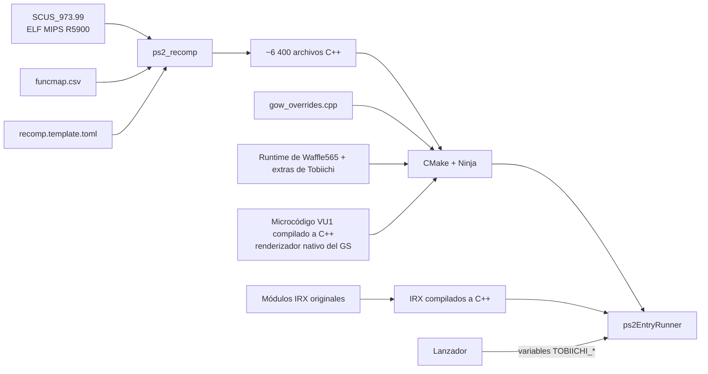

<div align="center">

# God of War — Tobiichi Port

[English](README.md) · [Türkçe](README.tr.md) · **Español**

**Port nativo para PC de *God of War* (PS2, NTSC-U `SCUS-97399`), hecho recompilando estáticamente código MIPS R5900 a C++, con su propio lanzador.**


</div>

---

> [!IMPORTANT]
> Este repositorio **no contiene ningún archivo del juego** (ISO, ejecutable, módulos IRX ni datos `.PAK`) ni el
> código C++ generado a partir de ellos. Necesitas **tu propia copia legal** de God of War para PS2.

## Índice

- [Qué es](#qué-es)
- [Lo más destacado](#lo-más-destacado)
- [Estado actual](#estado-actual)
- [Inicio rápido](#inicio-rápido)
- [God Of War: Tobiichi Launcher](#god-of-war-tobiichi-launcher)
- [Estructura del repositorio](#estructura-del-repositorio)
- [Cómo funciona](#cómo-funciona)
- [Documentación](#documentación)
- [Créditos y licencia](#créditos-y-licencia)

## Qué es

En lugar de emular la PlayStation 2 instrucción a instrucción, este proyecto **traduce el ejecutable original del
juego (`SCUS_973.99`) a C++** con [PS2Recomp](https://github.com/ran-j/PS2Recomp) y lo compila como un programa
nativo de PC. Desde la versión *Ultimate* funciona sobre el runtime de
[God-Of-War-Native-Port de Waffle565](https://github.com/Waffle565/God-Of-War-Native-Port): renderizador nativo del
GS por render targets en la GPU, los 8 módulos IRX del juego y su microcódigo de VU1 compilados por adelantado a C++,
vídeos, sonido, mando y tarjeta de memoria nativos. Tobiichi Port añade la compilación para Linux, el lanzador, el
panorámico Hor+ y sus extras de juego.

El objetivo es un port que se sienta nativo: velocidad de juego en tiempo real, imagen fluida, gráficos y sonido
correctos.

## Lo más destacado

| | |
|---|---|
| **Lanzador** | Tarjeta gráfica, resolución, relación de aspecto, filtro de imagen, límite de cuadros, rutas — todo en un sitio |
| **Panorámico** | Cámara Hor+ real (16:9, 16:10, 21:9), basada en el parche de PCSX2; los vídeos pasan a las versiones panorámicas del propio juego y llenan la pantalla |
| **Renderizador nativo** | Render targets del GS en la GPU (OpenGL 4.3+), resolución interna 1×–4× (2× por defecto) |
| **Imagen** | Bilineal (suave) o bicúbico con realce ajustable, FXAA opcional |
| **Vídeos** | Todos los vídeos se reproducen de forma nativa (libmpeg2) a velocidad real, con su sonido, y devuelven el control al juego |
| **IOP y VU1 nativos** | Los módulos IRX y el microcódigo de VU1 del juego funcionan como C++ compilado, no interpretado (~20 s hasta la partida) |
| **Fijar objetivo** | **Alt** fija el enemigo más cercano y Kratos dirige sus ataques a él; mover el ratón a izquierda o derecha cambia de objetivo |
| **Combate ágil** | Los ataques y bloqueos salen de una voltereta al 20 % en lugar del 50 %, y una pulsación de ataque perdida se reintenta un momento |
| **Menú de trucos** | **F2** en la partida: inmortalidad, matar de un golpe, magia y Furia de los Dioses infinitas, orbes al máximo, todas las mejoras y poderes, desbloquear todos los extras |
| **Aspecto original** | Los iconos de botones de PlayStation y el HUD del propio juego, sin cambios |

## Estado actual

| Hito | Estado |
|---|:---:|
| Recompilar `SCUS_973.99` a C++ (6.418 archivos) y compilarlo de forma nativa en Linux | ✅ |
| Arranque, menús, partida, mando y teclado/ratón | ✅ |
| Renderizador nativo del GS, panorámico Hor+, resolución interna 1×–4× | ✅ |
| Vídeos con sonido, a pantalla completa | ✅ |
| Módulos del IOP y VU1 como código nativo; sonido, mando, tarjeta de memoria | ✅ |
| Compilación para Windows de esta versión | 🔧 el código de Windows es el de Waffle565, aún sin recompilar aquí |

### Sobre los cuadros por segundo

La lógica del juego va atada al VBlank de 60 Hz de la PS2, así que **el juego no puede pasar de 60 cuadros/s**. En
un portátil con Radeon 680M (perfil de rendimiento) el combate en la cubierta del barco va a 50-60 cuadros/s a 1× y
a 46-47 a 2×; el límite es el hilo de VU1 (CPU). A 3× la GPU integrada se llena: con gráficos integrados, 2× o menos.
La opción de contador de cuadros del lanzador muestra en una esquina los del juego y los de la ventana.

## Inicio rápido

Necesitas tu propio `SCUS_973.99`, los módulos del disco (`*.IRX`) a su lado y la ISO original (`God of War.iso`
junto al ELF, o elígela en el lanzador). Pasos completos: [`docs/ULTIMATE.md`](docs/ULTIMATE.md).

### Linux

```bash
cd PS2Recomp
cmake -S . -B build -G Ninja -DCMAKE_BUILD_TYPE=Release -DPS2X_ENABLE_RUNTIME_LOGS=OFF \
  -DPS2X_ENABLE_AGRESSIVE_LOGS=OFF -DPS2X_ENABLE_IOP_RPC_TRACE=OFF -DPS2X_BUILD_STUDIO=OFF
ninja -C build ps2EntryRunner                              # tras colocar el código generado (docs/ULTIMATE.md)
cd .. && cmake -S launcher -B launcher/build -G Ninja -DCMAKE_BUILD_TYPE=Release
ninja -C launcher/build                                    # compilar el lanzador
launcher/build/tobiichi-launcher                           # ábrelo, revisa "Archivos" y pulsa JUGAR
```

Sin el lanzador: `./run_gow.sh`.

### Windows

El camino de Windows (WGL, vibración por XInput) viene sin cambios del runtime de Waffle565; esta versión aún no se ha
recompilado en Windows. Los pasos de Waffle565 están en [`docs/waffle/build-and-run.md`](docs/waffle/build-and-run.md).

## God Of War: Tobiichi Launcher

`launcher/` (Qt 6 Quick, en **turco / inglés / español**) guarda tus ajustes y arranca `ps2EntryRunner` con las
variables `TOBIICHI_*` correspondientes. Detalle: [`docs/LANZADOR.md`](docs/LANZADOR.md).

| Pestaña | Qué se puede ajustar |
|---|---|
| **Gráficos** | Tarjeta gráfica, pantalla completa/ventana y resolución, relación de aspecto (4:3, 16:9, 16:10, 21:9 Hor+), estirar, filtro de imagen bilineal / bicúbico, nitidez, FXAA, resolución de dibujo (1×–4×) |
| **Rendimiento** | Límite de FPS (30 … sin límite), VSync, contador de FPS en pantalla |
| **Archivos** | Ejecutable del juego (verificado por CRC), ISO, ejecutor del port, carpeta de la tarjeta de memoria, detección automática |
| **Controles** | Esquema de teclado, comportamiento de ESC, tabla de teclas |
| **Trucos** | Trucos activos al arrancar (el menú **F2** del juego los cambia al momento) |
| **Otros** | Idioma, omitir vídeos, arranque rápido, accesos directos, registro de la última partida, restablecer, imagen de portada opcional |

`tobiichi-launcher --jugar` arranca el juego directamente con los ajustes guardados (la acción "Jugar ya" de la
entrada del menú). En el juego: **F11** alterna la pantalla completa, **F2** abre el menú de trucos y **F1** el panel de desarrollo.

## Estructura del repositorio

```
.
├── config/                       # Mapa de funciones y configuración del recompilador (incl. parche panorámico)
├── docs/                         # Documentación técnica y mapa de estado
├── launcher/                     # God Of War: Tobiichi Launcher (Qt 6)
├── patches/                      # Cambios sobre PS2Recomp, aplicados en orden
├── scripts/                      # Scripts de compilación, prueba y ejecución
├── src/                          # Reemplazos específicos del juego
├── tests/                        # Pruebas independientes del juego
├── tools/                        # Generador de VU1, mapa de estado, diagnóstico
├── PS2Recomp/                    # Runtime y recompilador (árbol de trabajo)
└── run_gow.sh                    # Script de arranque en Linux sin el lanzador
```

## Cómo funciona



## Documentación

- [`docs/ESTADO.md`](docs/ESTADO.md) — registro de la investigación: qué se probó y con qué resultado.
- [`docs/LANZADOR.md`](docs/LANZADOR.md) — lanzador, capa de presentación y panorámica.
- [`docs/RENDIMIENTO.md`](docs/RENDIMIENTO.md), [`docs/RENDERIZADO.md`](docs/RENDERIZADO.md), [`docs/CONTROLES.md`](docs/CONTROLES.md), [`docs/FMV_Y_AUDIO.md`](docs/FMV_Y_AUDIO.md), [`docs/MEMORY_CARD.md`](docs/MEMORY_CARD.md), [`docs/ARQUITECTURA.md`](docs/ARQUITECTURA.md).

Convenciones para colaborar: [`AGENTS.md`](AGENTS.md).

## Créditos y licencia

- [**PS2Recomp**](https://github.com/ran-j/PS2Recomp) de ran-j y colaboradores — recompilador y runtime (GPL-3.0).
- [**God-Of-War-Native-Port de Waffle565**](https://github.com/Waffle565/God-Of-War-Native-Port) — el runtime de la versión Ultimate: renderizador nativo del GS, IOP y VU1 compilados, vídeos, sonido y tarjeta de memoria nativos (GPL-3.0).
- [**Fork del runtime de SotC**](https://github.com/LightVelox/PS2Recomp/tree/ac9efa070638ad3b3accd284de6f898d5ab271d1) de Taylor N. Albarnaz / LightVelox — backend GS OpenGL, cola de comandos y arreglos del EE (GPL-3.0).
- [**god-of-war-recomp de KIexster**](https://github.com/KIexster/god-of-war-recomp) — la tubería de recompilación de God of War y los parches de VU1/VIF sobre los que se construye este port.
- Panorámica: basada en el parche "Widescreen 16:9" de PCSX2 para SCUS-97399, de nemesis2000 y CRASHARKI.
- Lanzador: fuente [Cinzel](https://github.com/NDISCOVER/Cinzel) (SIL OFL 1.1, `launcher/recursos/fuentes/OFL.txt`).
- *God of War* © Sony Interactive Entertainment / Santa Monica Studio. Este proyecto no está afiliado ni respaldado por Sony. No se distribuye ningún contenido del juego.

El código de este repositorio se publica bajo la licencia **GPL-3.0**, en coherencia con PS2Recomp. Ver [`LICENSE`](LICENSE).
