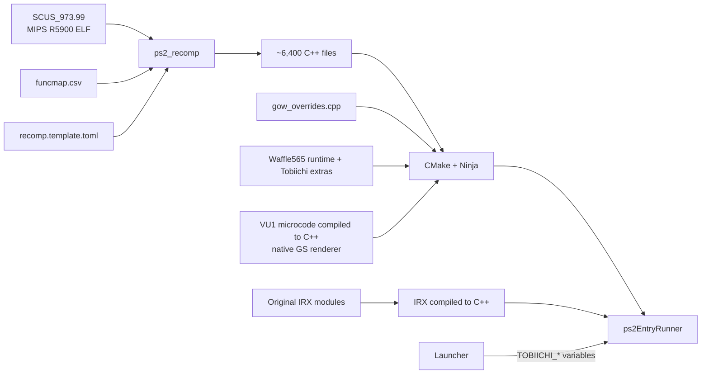

<div align="center">

# God of War — Tobiichi Port

**English** · [Türkçe](README.tr.md) · [Español](README.es.md)

**A native PC port of *God of War* (PS2, NTSC-U `SCUS-97399`), built by statically recompiling MIPS R5900 code to C++, with its own launcher.**


</div>

---

> [!IMPORTANT]
> This repository **does not contain any game files** (ISO, executable, IRX modules or `.PAK` data), nor the C++
> code generated from them. You need **your own legal copy** of God of War for the PS2.

## Contents

- [What is this?](#what-is-this)
- [Highlights](#highlights)
- [Current status](#current-status)
- [Quick start](#quick-start)
- [God Of War: Tobiichi Launcher](#god-of-war-tobiichi-launcher)
- [Repository layout](#repository-layout)
- [How it works](#how-it-works)
- [Documentation](#documentation)
- [Credits and license](#credits-and-license)

## What is this?

Instead of emulating the PlayStation 2 one instruction at a time, this project **translates the game's original
executable (`SCUS_973.99`) into C++** with [PS2Recomp](https://github.com/ran-j/PS2Recomp) and compiles it as a
native PC program. Since the *Ultimate* release it runs on the runtime of
[Waffle565's God-Of-War-Native-Port](https://github.com/Waffle565/God-Of-War-Native-Port): a native render-target
GS renderer, the game's 8 IRX modules and its VU1 microcode compiled ahead of time to C++, native movies, sound,
pad and memory card. Tobiichi Port adds the Linux build, the launcher, Hor+ widescreen and its gameplay extras.

The goal is a native-feeling PC port: real-time game speed, smooth presentation, correct graphics and sound.

## Highlights

| | |
|---|---|
| **Launcher** | Graphics card, resolution, aspect ratio, image filter, frame-rate limit, file paths — all in one place |
| **Widescreen** | Real Hor+ camera (16:9, 16:10, 21:9), based on the PCSX2 patch; movies switch to the game's own widescreen versions and fill the screen |
| **Native renderer** | GS render targets on the GPU (OpenGL 4.3+), internal resolution 1×–4× (2× by default) |
| **Image** | Bilinear (soft) or bicubic with adjustable sharpening, optional FXAA |
| **Movies** | All movies play natively (libmpeg2) at real speed with their sound, then hand over to the game |
| **Native IOP and VU1** | The game's IRX modules and VU1 microcode run as compiled C++, not interpreted (boot to gameplay in ~20 s) |
| **Lock-on** | **Alt** locks onto the nearest enemy and Kratos aims his attacks at it; move the mouse left/right to switch targets |
| **Agile combat** | Attacks and blocks come out of a roll at 20 % instead of 50 %, and a missed attack press is retried for a moment |
| **Cheat menu** | **F2** in game: god mode, one-hit kills, infinite magic and Rage of the Gods, max orbs, all upgrades and powers, unlock all extras |
| **Original look** | The game's own PlayStation button prompts and HUD, unchanged |

## Current status

| Milestone | Status |
|---|:---:|
| Recompiling `SCUS_973.99` to C++ (6,418 files) and building natively on Linux | ✅ |
| Boot, menus, gameplay, controller and keyboard/mouse | ✅ |
| Native GS renderer, Hor+ widescreen, internal resolution 1×–4× | ✅ |
| Movies with sound, full screen | ✅ |
| IOP modules and VU1 as native code; sound, pad, memory card | ✅ |
| Windows build of this release | 🔧 the Windows code is Waffle565's, not yet rebuilt here |

### About frame rate

The game's logic is locked to the PS2's 60 Hz VBlank, so **the game itself cannot run above 60 FPS**. On a laptop
with a Radeon 680M (performance power profile) the ship-deck combat runs at 50–60 FPS at 1× and 46–47 at 2×; the
limit there is the VU1 thread (CPU). At 3× the integrated GPU is full: use 2× or less on integrated graphics.
The launcher's FPS counter option draws the game and window rates in a corner.

## Quick start

You need your own `SCUS_973.99`, the disc modules (`*.IRX`) next to it, and the original ISO (`God of War.iso`
next to the ELF, or choose it in the launcher). Full build steps: [`docs/ULTIMATE.md`](docs/ULTIMATE.md).

### Linux

```bash
cd PS2Recomp
cmake -S . -B build -G Ninja -DCMAKE_BUILD_TYPE=Release -DPS2X_ENABLE_RUNTIME_LOGS=OFF \
  -DPS2X_ENABLE_AGRESSIVE_LOGS=OFF -DPS2X_ENABLE_IOP_RPC_TRACE=OFF -DPS2X_BUILD_STUDIO=OFF
ninja -C build ps2EntryRunner                              # after placing the generated code (docs/ULTIMATE.md)
cd .. && cmake -S launcher -B launcher/build -G Ninja -DCMAKE_BUILD_TYPE=Release
ninja -C launcher/build                                    # build the launcher
launcher/build/tobiichi-launcher                           # open it, check "Files", press PLAY
```

Without the launcher: `./run_gow.sh`.

### Windows

The Windows code path (WGL, XInput rumble) comes from Waffle565's runtime unchanged; this release has not been rebuilt
on Windows yet. Waffle565's steps are in [`docs/waffle/build-and-run.md`](docs/waffle/build-and-run.md).

## God Of War: Tobiichi Launcher

`launcher/` (Qt 6 Quick, **Turkish / English / Spanish**) saves your settings and starts `ps2EntryRunner` with the
matching `TOBIICHI_*` variables. Details: [`docs/LANZADOR.md`](docs/LANZADOR.md).

| Tab | What you can set |
|---|---|
| **Graphics** | Graphics card, fullscreen/window and resolution, aspect ratio (4:3, 16:9, 16:10, 21:9 Hor+), stretch, bilinear / bicubic image filter, sharpness, FXAA, render resolution (1×–4×) |
| **Performance** | Frame-rate limit (30 … unlimited), VSync, on-screen FPS counter |
| **Files** | Game executable (verified by CRC), ISO, port runner, memory-card folder, automatic detection |
| **Controls** | Keyboard layout, ESC behaviour, key table |
| **Cheats** | Cheats active at start (the in-game **F2** menu toggles them live) |
| **Other** | Language, skip videos, fast boot, shortcuts, last game log, restore defaults, optional cover image |

`tobiichi-launcher --jugar` starts the game directly with the saved settings (the menu entry's "Play now" action).
In game: **F11** toggles fullscreen, **F2** opens the cheat menu and **F1** opens the developer panel.

## Repository layout

```
.
├── config/                       # Function map and recompiler configuration (incl. widescreen patch)
├── docs/                         # Technical documentation (Spanish) and status map
├── launcher/                     # God Of War: Tobiichi Launcher (Qt 6)
├── patches/                      # Changes on top of PS2Recomp, applied in order
├── scripts/                      # Build, test and run scripts
├── src/                          # Game-specific overrides
├── tests/                        # Game-independent tests
├── tools/                        # VU1 generator, status map, diagnostics
├── PS2Recomp/                    # Runtime and recompiler (working tree)
└── run_gow.sh                    # Linux launch script without the launcher
```

## How it works



## Documentation

- [`docs/ESTADO.md`](docs/ESTADO.md) — research log: what was tried, with which result.
- [`docs/LANZADOR.md`](docs/LANZADOR.md) — launcher, presentation layer and widescreen.
- [`docs/RENDIMIENTO.md`](docs/RENDIMIENTO.md), [`docs/RENDERIZADO.md`](docs/RENDERIZADO.md), [`docs/CONTROLES.md`](docs/CONTROLES.md), [`docs/FMV_Y_AUDIO.md`](docs/FMV_Y_AUDIO.md), [`docs/MEMORY_CARD.md`](docs/MEMORY_CARD.md), [`docs/ARQUITECTURA.md`](docs/ARQUITECTURA.md).

Technical documentation is written in Spanish. Contributor conventions: [`AGENTS.md`](AGENTS.md).

## Credits and license

- [**PS2Recomp**](https://github.com/ran-j/PS2Recomp) by ran-j and contributors — recompiler and runtime (GPL-3.0).
- [**Waffle565's God-Of-War-Native-Port**](https://github.com/Waffle565/God-Of-War-Native-Port) — the runtime of the Ultimate release: native GS renderer, compiled IOP and VU1, native movies, sound and memory card (GPL-3.0).
- [**SotC runtime fork**](https://github.com/LightVelox/PS2Recomp/tree/ac9efa070638ad3b3accd284de6f898d5ab271d1) by Taylor N. Albarnaz / LightVelox — OpenGL GS backend, command queue and EE fixes (GPL-3.0).
- [**KIexster's god-of-war-recomp**](https://github.com/KIexster/god-of-war-recomp) — the God of War recompilation pipeline and VU1/VIF patches this port builds on.
- Widescreen: based on the PCSX2 "Widescreen 16:9" patch for SCUS-97399 by nemesis2000 and CRASHARKI.
- Launcher: [Cinzel](https://github.com/NDISCOVER/Cinzel) font (SIL OFL 1.1, `launcher/recursos/fuentes/OFL.txt`).
- *God of War* © Sony Interactive Entertainment / Santa Monica Studio. This project is not affiliated with or endorsed by Sony. No game content is distributed.

The code in this repository is released under **GPL-3.0**, consistent with PS2Recomp. See [`LICENSE`](LICENSE).
