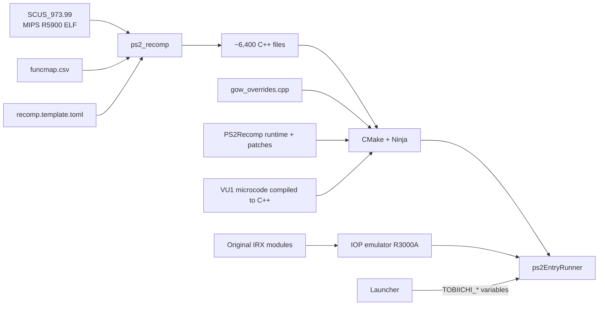

<div align="center">

# God of War — Tobiichi Port

**English** · [Türkçe](README.tr.md) · [Español](README.es.md)

**A native PC port of *God of War* (PS2, NTSC-U `SCUS-97399`), built by statically recompiling MIPS R5900 code to C++, with its own launcher.**


</div>

---

> [!IMPORTANT]
> This repository **does not contain any game files** (ISO, executable, IRX modules or `.PAK` data), nor the C++
> code generated from them. You need **your own legal copy** of God of War for the PS2.

## Contents

- [What is this?](#what-is-this)
- [Highlights](#highlights)
- [Current status](#current-status)
- [Quick start](#quick-start)
- [God Of War: Tobiichi Launcher](#god-of-war-tobiichi-launcher)
- [Repository layout](#repository-layout)
- [How it works](#how-it-works)
- [Documentation](#documentation)
- [Credits and license](#credits-and-license)

## What is this?

Instead of emulating the PlayStation 2 one instruction at a time, this project **translates the game's original
executable (`SCUS_973.99`) into C++** with [PS2Recomp](https://github.com/ran-j/PS2Recomp) and compiles it as a
native PC program, linked against a runtime that reimplements the PS2 hardware and operating system (EE kernel, GS,
VU1, DMA, SPU2, CD/DVD…). The I/O processor (IOP) runs the game's **original IRX modules** (sound driver, data
streamer…) on an R3000A interpreter.

The goal is a native-feeling PC port: real-time game speed, smooth presentation, correct graphics and sound.

## Highlights

| | |
|---|---|
| **Launcher** | Graphics card, resolution, widescreen, FSR upscaling, frame-rate limit, file paths — all in one place |
| **Widescreen** | Real Hor+ camera (16:9, 16:10, 21:9), based on the PCSX2 patch; off = bit-identical to the original |
| **Upscaling** | AMD FSR 1.0 (EASU + RCAS) and FXAA on the presentation layer |
| **Smooth window** | The window presents at up to 120+ FPS independently of the game's 60 Hz logic |
| **Audio** | Time-stretch with a dead band and an IOP clock tied to EE time: tempo stays at 1.00, no looping |
| **VU1 recompiled** | The game's VU1 microcode is compiled to native code, bit-exact against the interpreter (~23 % faster than before) |
| **Real-time speed** | VBlank follows the wall clock: the game drops frames instead of running in slow motion |

## Current status

<a href="docs/estado/detalle.en.md"></a>

Per-library and per-component breakdown: [`docs/estado/detalle.en.md`](docs/estado/detalle.en.md).

| Milestone | Status |
|---|:---:|
| Recompiling `SCUS_973.99` to C++ (6,418 files) and building natively | ✅ |
| Original IRX modules on the IOP emulator; streaming from the original ISO | ✅ |
| Menus, difficulty selection, gameplay, controller and keyboard/mouse | ✅ |
| Rendering (OpenGL; hardware rasterizer with `fragment_shader_interlock` or compute rasterizer) | ✅ |
| Audio at real-time tempo | ✅ |
| Widescreen (Hor+) and FSR upscaling | ✅ |
| FMV: intro decoded and displayed; other videos unverified | 🔧 |
| Memory card: save/load verified; formatting unverified | 🔧 |
| Performance: 60 FPS in light and medium scenes, **~30 FPS in the heaviest ones** | 🔧 |

### About frame rate

The game's logic is locked to the PS2's 60 Hz VBlank, so **the game itself cannot run above 60 FPS**; forcing a higher
VBlank rate only makes it play faster. The window can present at 120 Hz or more, which shows each new frame sooner and
lowers latency. In the heaviest scenes the VU1 thread needs ~20 ms per frame (60 FPS needs ≤ ~15 ms) and the CPU is
the limit; a dedicated GPU matters for the GS rasterizer (4–7 ms per frame on an RTX 4050 vs. 20–26 ms on a Radeon 680M).

**Not available:** 2×–4× internal resolution. The GS is emulated at its native 640×448 on its interleaved VRAM;
supersampling it is a large project. Use FSR for sharpness.

## Quick start

You need your own `SCUS_973.99`, the disc modules (`*.IRX`) next to it, and the original ISO (named `God of War.iso`,
in the folder above the ELF, or set `GOW_ISO`). See [Requirements](docs/ARQUITECTURA.md) for the full list.

### Linux

```bash
cd PS2Recomp
cmake --build build --target ps2EntryRunner -j$(nproc)    # build the game runner
cd .. && cmake -S launcher -B launcher/build -G Ninja -DCMAKE_BUILD_TYPE=Release
ninja -C launcher/build                                    # build the launcher
launcher/build/tobiichi-launcher                           # open it, check "Files", press PLAY
```

Without the launcher: `./run_gow.sh`. It uses the system's default GPU; `TOBIICHI_GPU=nvidia ./run_gow.sh` forces the
dedicated NVIDIA card (PRIME offload).

### Windows

```bat
scripts\1_instalar_herramientas.cmd   :: first time only (Git and Build Tools through winget)
scripts\2_compilar.cmd                :: 20–40 min the first time
scripts\3_ejecutar.cmd
```

## God Of War: Tobiichi Launcher

`launcher/` (Qt 6 Quick, **Turkish / English / Spanish**) saves your settings and starts `ps2EntryRunner` with the
matching `TOBIICHI_*` variables. Details: [`docs/LANZADOR.md`](docs/LANZADOR.md).

| Tab | What you can set |
|---|---|
| **Graphics** | Graphics card, fullscreen/window and resolution, aspect ratio (4:3, 16:9, 16:10, 21:9 Hor+), stretch, FSR / bilinear / pixel upscaling, sharpness, FXAA |
| **Performance** | Frame-rate limit (30 … unlimited), VSync, on-screen FPS counter |
| **Files** | Game executable (verified by CRC), ISO, port runner, memory-card folder, automatic detection |
| **Controls** | Keyboard layout, ESC behaviour, key table |
| **Other** | Language, skip videos, fast boot, shortcuts, last game log, restore defaults, optional cover image |

`tobiichi-launcher --jugar` starts the game directly with the saved settings (the menu entry's "Play now" action).
In game: **F11** toggles fullscreen and **F1** opens the developer panel.

## Repository layout

```
.
├── config/                       # Function map and recompiler configuration (incl. widescreen patch)
├── docs/                         # Technical documentation (Spanish) and status map
├── launcher/                     # God Of War: Tobiichi Launcher (Qt 6)
├── patches/                      # Changes on top of PS2Recomp, applied in order
├── scripts/                      # Build, test and run scripts
├── src/                          # Game-specific overrides
├── tests/                        # Game-independent tests
├── tools/                        # VU1 generator, status map, diagnostics
├── PS2Recomp/                    # Runtime and recompiler (working tree)
└── run_gow.sh                    # Linux launch script without the launcher
```

## How it works



## Documentation

- [`docs/ESTADO.md`](docs/ESTADO.md) — research log: what was tried, with which result.
- [`docs/LANZADOR.md`](docs/LANZADOR.md) — launcher, presentation layer and widescreen.
- [`docs/RENDIMIENTO.md`](docs/RENDIMIENTO.md), [`docs/RENDERIZADO.md`](docs/RENDERIZADO.md), [`docs/CONTROLES.md`](docs/CONTROLES.md), [`docs/FMV_Y_AUDIO.md`](docs/FMV_Y_AUDIO.md), [`docs/MEMORY_CARD.md`](docs/MEMORY_CARD.md), [`docs/ARQUITECTURA.md`](docs/ARQUITECTURA.md).

Technical documentation is written in Spanish. Contributor conventions: [`AGENTS.md`](AGENTS.md).

## Credits and license

- [**PS2Recomp**](https://github.com/ran-j/PS2Recomp) by ran-j and contributors — recompiler and runtime (GPL-3.0).
- [**SotC runtime fork**](https://github.com/LightVelox/PS2Recomp/tree/ac9efa070638ad3b3accd284de6f898d5ab271d1) by Taylor N. Albarnaz / LightVelox — OpenGL GS backend, command queue and EE fixes (GPL-3.0).
- [**KIexster's god-of-war-recomp**](https://github.com/KIexster/god-of-war-recomp) — the God of War recompilation pipeline and VU1/VIF patches this port builds on.
- Widescreen: based on the PCSX2 "Widescreen 16:9" patch for SCUS-97399 by nemesis2000 and CRASHARKI.
- Launcher: [Cinzel](https://github.com/NDISCOVER/Cinzel) font (SIL OFL 1.1, `launcher/recursos/fuentes/OFL.txt`); upscaling ported from AMD FidelityFX Super Resolution 1.0 (MIT).
- *God of War* © Sony Interactive Entertainment / Santa Monica Studio. This project is not affiliated with or endorsed by Sony. No game content is distributed.

The code in this repository is released under **GPL-3.0**, consistent with PS2Recomp. See [`LICENSE`](LICENSE).
