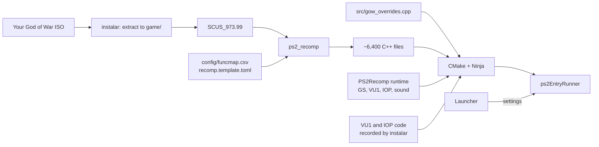

<div align="center">

# God of War — Tobiichi Port

**English** · [Türkçe](README.tr.md) · [Español](README.es.md)

**A native PC port of *God of War* (PlayStation 2, NTSC-U `SCUS-97399`) for Linux and Windows.
The game's code is statically recompiled from MIPS to C++; the PS2 hardware is replaced by native code, not emulated.**


</div>

---

> [!IMPORTANT]
> This repository **contains no game files** (ISO, executable, IRX modules, `.PAK` data) and no code generated from
> them. You need **your own legal copy** of *God of War* for the PS2 (USA version, `SCUS-97399`). The installer
> builds everything on your computer from your own disc image; nothing derived from the game ever leaves it.

## Contents

- [About the name](#about-the-name)
- [What is this?](#what-is-this)
- [Features](#features)
- [Requirements](#requirements)
- [Installation on Windows](#installation-on-windows)
- [Installation on Linux](#installation-on-linux)
- [Playing](#playing)
- [Performance](#performance)
- [Updating](#updating)
- [Troubleshooting](#troubleshooting)
- [How it works](#how-it-works)
- [Repository layout](#repository-layout)
- [Contributors](#contributors)
- [Credits and license](#credits-and-license)

## About the name

The project is named after **Origami Tobiichi** (鳶一折紙), from the anime and light novel series
***Date A Live*** (DAL).

## What is this?

Instead of emulating the PlayStation 2 one instruction at a time, this project **translates the game's original
executable (`SCUS_973.99`) into C++** with [PS2Recomp](https://github.com/ran-j/PS2Recomp) and compiles it into a
native program. Around the game code sits a runtime that does the PS2 hardware's job natively:

| PS2 part | In this port |
|---|---|
| **EE CPU** (game code) | Recompiled to C++ (~6,400 functions) |
| **VU1** (vector unit microcode) | Compiled ahead of time to C++ from the microcode the game uses |
| **GS** (graphics) | Native OpenGL renderer with GPU render targets, internal resolution 1×–4× |
| **IOP** (I/O CPU) | The game's IRX modules compiled ahead of time to C++ |
| **Sound, pad, memory card, movies** | Native services: sound engine, gamepad/keyboard/mouse, `.ps2` memory card, MPEG-2 movies (libmpeg2) |

## Features

| | |
|---|---|
| **Launcher** | Graphics card, window/fullscreen, resolution, aspect ratio, image filter, internal resolution, frame-rate limit, keyboard layout, cheats — Turkish, English and Spanish |
| **Widescreen** | Real Hor+ camera (16:9, 16:10, 21:9) based on the PCSX2 patch; movies switch to the game's own widescreen versions and fill the screen |
| **Image** | Soft bilinear or bicubic with adjustable sharpening, optional FXAA |
| **Movies** | Every movie plays natively at real speed, with its sound |
| **Original look** | The game's own PlayStation button prompts and HUD |
| **Keyboard and mouse** | A full, remappable keyboard and mouse layout; any gamepad works too |
| **Lock-on** | **Alt** locks onto the nearest enemy; move the mouse left/right to switch targets |
| **Agile combat** | Attacks and blocks come out of a roll sooner, and a missed attack press is retried for a moment |
| **Cheat menu** | **F2** in game: god mode, one-hit kills, infinite magic and Rage of the Gods, max orbs, all upgrades and powers, unlock all extras |
| **On-screen FPS** | Game and window frame rates in a corner (launcher option) |

## Requirements

- **Your own *God of War* (USA, `SCUS-97399`) disc image** as an `.iso` file (about 8 GB). Make it from your own disc
  with any DVD ripping tool.
- **20 GB of free disk space** (the extracted disc, about 8 GB, plus the build).
- **A 64-bit x86 CPU** (4 cores or more recommended; on Windows it must support **AVX2**, which every Intel CPU since
  2013 and every AMD CPU since 2015 does) and **8 GB of RAM** (16 GB recommended while building).
- **A GPU with OpenGL 4.3 or newer**: any NVIDIA/AMD card, or the integrated graphics of a recent Intel/AMD CPU.
- **Windows 10/11 x64** or a **Linux** distribution (Arch/CachyOS, Ubuntu 24.04+, Fedora 40+ or similar).
- Time: the first build takes **30–90 minutes** depending on the CPU. Later updates only rebuild what changed.

## Installation on Windows

1. **Get the project.** Click **Code → Download ZIP** on GitHub and unzip it, or with Git:
   ```bat
   git clone https://github.com/YYOzcan/Tobiichi-Port.git
   ```
   Use a short path without special characters if you can (for example `C:\Games\Tobiichi-Port`).
2. **Copy your disc image** into the `game` folder of the project and name it `God of War.iso`.
3. **First time only — install the build tools.** Open the project folder, type `cmd` in the address bar, press Enter
   and run:
   ```bat
   instalar.cmd -Herramientas
   ```
   This installs Git, Python 3 and the Visual Studio 2022 Build Tools (C++ compiler, CMake and Ninja) with `winget`.
   Windows asks for administrator permission; accept it. It takes 15–30 minutes and then continues with step 4 on
   its own.
4. **Build.** If the tools are already installed, simply **double-click `instalar.cmd`**. The installer:
   1. extracts the disc into `game\` (the `.iso` is no longer needed afterwards);
   2. builds the recompiler and translates `SCUS_973.99` into C++;
   3. builds the game (`ps2EntryRunner.exe`) and the launcher — Qt 6 is downloaded automatically into
      `herramientas\qt` if it is not installed;
   4. **optimizes**: the game opens by itself for 4 minutes and plays the start of the first level with automatic
      button presses. **Do not touch the keyboard or mouse during this step.** It records the VU1 microcode and the
      IOP modules the game uses and rebuilds them as native code (much faster);
   5. creates a **God Of War - Tobiichi Port** shortcut on the desktop and in the Start menu.
5. **Play** from the shortcut. In the launcher, check the **Files** tab once (everything should be detected) and
   press **PLAY**.

Options: `instalar.cmd -Iso "D:\path\God of War.iso"` uses an image from another folder; `-SinOptimizar` skips
step 4.4; `-Optimizar` repeats it later.

## Installation on Linux

1. **Install the dependencies.**
   - **Arch / CachyOS / Manjaro:**
     ```bash
     sudo pacman -S --needed base-devel cmake ninja python git qt6-base qt6-declarative qt6-svg
     ```
   - **Ubuntu / Debian:**
     ```bash
     sudo apt install build-essential cmake ninja-build python3 git libgl-dev libx11-dev libxrandr-dev \
       libxinerama-dev libxcursor-dev libxi-dev libxkbcommon-dev libwayland-dev libasound2-dev qt6-base-dev qt6-declarative-dev \
       qml6-module-qtquick-controls qml6-module-qtquick-layouts qml6-module-qtquick-dialogs \
       qml6-module-qtquick-effects qml6-module-qtquick-shapes qml6-module-qtquick-particles qml6-module-qtcore
     ```
   - **Fedora:**
     ```bash
     sudo dnf install gcc-c++ cmake ninja-build python3 git mesa-libGL-devel libX11-devel libXrandr-devel \
       libXinerama-devel libXcursor-devel libXi-devel libxkbcommon-devel wayland-devel alsa-lib-devel \
       qt6-qtbase-devel qt6-qtdeclarative-devel
     ```
2. **Get the project:**
   ```bash
   git clone https://github.com/YYOzcan/Tobiichi-Port.git
   cd Tobiichi-Port
   ```
3. **Copy your disc image** to `game/God of War.iso` (or pass its path in the next step).
4. **Run the installer:**
   ```bash
   ./instalar.sh                                  # or: ./instalar.sh "/path/to/God of War.iso"
   ```
   It does the same steps as on Windows: extracts the disc into `game/`, generates the C++ code, builds the game and
   the launcher, **optimizes** (the game opens by itself for 4 minutes — do not touch the keyboard or mouse) and adds
   **God Of War: Tobiichi Port** to the applications menu.
   Options: `--sin-optimizar`, `--optimizar [seconds]`, `--jobs N`.
5. **Play** from the applications menu, or `launcher/build/tobiichi-launcher`. Without the launcher: `./run_gow.sh`.

## Playing

**Keyboard and mouse (default layout, remappable in the launcher):**

| Action | Key | Action | Key |
|---|---|---|---|
| Move | **W A S D** | Evade (right stick) | **Ctrl + W A S D** |
| Light attack (□) | **Left click** | Heavy attack (△) | **Right click** |
| Jump (✕) | **Space** | Grab (○) | **F** |
| Block (L1) | **Q** | R1 | **E** |
| L2 / R2 (magic) | **Shift / Ctrl** | Rage of the Gods | **V** |
| Magic 1–4 | **1 2 3 4** | Blade of Artemis (L1 + R1) | **Middle click** |
| D-pad | **Arrow keys** | Camera (right stick) | **I J K L** |
| Start / Select | **Enter / Tab** | Lock-on | **Alt** (mouse switches target) |

**Hotkeys:** **F2** cheat menu · **F11** fullscreen · **F1** developer panel. **Gamepads:** DualShock 4, DualSense,
Xbox and other controllers work out of the box (vibration on Windows).

**Memory card:** saves go to `game/Mcd001.ps2` (a PCSX2-compatible card image; you can copy your PCSX2 card there).

## Performance

The game's logic is tied to the PS2's 60 Hz VBlank, so **the game itself never runs above 60 FPS**; the port keeps it
at real speed (it drops frames rather than slowing down).

- **Dedicated GPU (NVIDIA/AMD):** internal resolution 2×–3× at 60 FPS is typical.
- **Integrated graphics** (for example Radeon 680M): 1×–2×. Measured on the ship deck combat at 1×: 50–60 FPS with
  the *performance* power profile; on battery/*power saver* the CPU clock drops and so does the frame rate.
- The heaviest part is the VU1 thread (CPU). Running the optimization step again after playing new areas
  (`./instalar.sh --optimizar` / `instalar.cmd -Optimizar`) turns more of it into native code.

## Updating

```bash
git pull
./instalar.sh          # Windows: instalar.cmd
```
Only the files that changed are rebuilt; the extracted disc and the recorded VU1/IOP code are kept.

## Troubleshooting

| Problem | Fix |
|---|---|
| "I can't find the ISO" | Put it at `game/God of War.iso` or pass the path to the installer. Only the USA version (`SCUS-97399`) works. |
| The game runs slowly | Run the optimization step (`--optimizar`); choose 1× or 2× internal resolution; use the *performance* power profile on laptops. |
| The launcher did not build on Linux | Install the Qt 6 packages listed above, then run `./instalar.sh` again. `./run_gow.sh` plays without it. |
| Windows: "Visual Studio is missing" | Run `instalar.cmd -Herramientas`. |
| Black screen or crash on an old GPU | The renderer needs OpenGL 4.3; update the graphics driver. |
| Where are the logs? | Launcher: **Other → Last game log**. Installer: `build-gen/` (`recomp.log`, `optimizar.log`). |

## How it works



More: [`docs/ULTIMATE.md`](docs/ULTIMATE.md) (this release, in Spanish), [`docs/waffle/`](docs/waffle/README.md)
(Waffle565's documentation of the runtime, in English), [`docs/`](docs/) (research log and older notes, in Spanish).

## Repository layout

```
.
├── instalar.sh / instalar.cmd / instalar.ps1   # installers (Linux / Windows)
├── run_gow.sh                                  # play without the launcher (Linux)
├── game/                                       # your extracted disc goes here (ignored by git)
├── config/                                     # function map and recompiler configuration (incl. widescreen patch)
├── src/                                        # game overrides (gow_overrides.cpp)
├── PS2Recomp/                                  # recompiler and runtime (GS, VU1, IOP, sound, pad, memory card)
├── launcher/                                   # God Of War: Tobiichi Launcher (Qt 6)
├── tools/                                      # VU1/IOP code generators, ISO extractor, diagnostics
└── docs/                                       # documentation
```

## Contributors

<table>
  <tr>
    <td align="center"><a href="https://github.com/YYOzcan"><br/><b>YYOzcan</b></a><br/>Tobiichi Port: Linux port, launcher, widescreen, gameplay extras, integration</td>
    <td align="center"><a href="https://github.com/Waffle565"><br/><b>Waffle565</b></a><br/><a href="https://github.com/Waffle565/God-Of-War-Native-Port">God-Of-War-Native-Port</a>: native GS renderer, IOP and VU1 compiled to C++, movies, sound, memory card</td>
    <td align="center"><a href="https://github.com/KIexster"><br/><b>KIexster</b></a><br/><a href="https://github.com/KIexster/god-of-war-recomp">god-of-war-recomp</a>: the God of War recompilation pipeline, VU1 compiler and runtime fixes this port is built on</td>
  </tr>
</table>

## Credits and license

- [**PS2Recomp**](https://github.com/ran-j/PS2Recomp) by ran-j and contributors — recompiler and runtime (GPL-3.0).
- [**LightVelox's SotC runtime fork**](https://github.com/LightVelox/PS2Recomp/tree/ac9efa070638ad3b3accd284de6f898d5ab271d1) (Taylor N. Albarnaz) — OpenGL GS context and EE fixes (GPL-3.0).
- [**PCSX2**](https://github.com/PCSX2/pcsx2) — reference for verification; VU interpreter and EE reference code (GPL-3.0+).
- Widescreen based on the PCSX2 "Widescreen 16:9" patch for SCUS-97399 by nemesis2000 and CRASHARKI.
- [libmpeg2](https://libmpeg2.sourceforge.io/) (GPL-2.0+), [raylib](https://www.raylib.com/) (zlib), [Dear ImGui](https://github.com/ocornut/imgui) (MIT), [Qt 6](https://www.qt.io/) (LGPL-3.0), [Cinzel](https://github.com/NDISCOVER/Cinzel) font (SIL OFL 1.1).
- *God of War* © Sony Interactive Entertainment / Santa Monica Studio. This project is not affiliated with or
  endorsed by Sony. No game content is distributed. *Date A Live* and Origami Tobiichi © Koushi Tachibana / Tsunako /
  KADOKAWA.

The code in this repository is released under the **GNU General Public License v3.0**, like PS2Recomp. See
[`LICENSE`](LICENSE).
