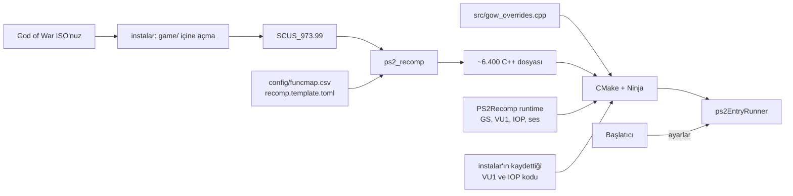

<div align="center">

# God of War — Tobiichi Port

[English](README.md) · **Türkçe** · [Español](README.es.md)

***God of War*'un (PlayStation 2, NTSC-U `SCUS-97399`) Linux ve Windows için yerel PC portu.
Oyunun kodu MIPS'ten C++'a statik olarak yeniden derlenir; PS2 donanımı emüle edilmez, yerel kodla değiştirilir.**


</div>

---

> [!IMPORTANT]
> Bu depo **hiçbir oyun dosyası içermez** (ISO, çalıştırılabilir dosya, IRX modülleri, `.PAK` verisi) ve bunlardan
> üretilmiş kod da içermez. PS2 için *God of War*'un **kendi yasal kopyanız** gerekir (ABD sürümü, `SCUS-97399`).
> Kurulum her şeyi sizin bilgisayarınızda, sizin disk kalıbınızdan üretir; oyundan türetilen hiçbir şey dışarı çıkmaz.

## İçindekiler

- [İsim hakkında](#i̇sim-hakkında)
- [Bu nedir?](#bu-nedir)
- [Özellikler](#özellikler)
- [Gereksinimler](#gereksinimler)
- [Windows'ta kurulum](#windowsta-kurulum)
- [Linux'ta kurulum](#linuxta-kurulum)
- [Oynamak](#oynamak)
- [Performans](#performans)
- [Güncelleme](#güncelleme)
- [Sorun giderme](#sorun-giderme)
- [Nasıl çalışır?](#nasıl-çalışır)
- [Depo yapısı](#depo-yapısı)
- [Katkıda bulunanlar](#katkıda-bulunanlar)
- [Emeği geçenler ve lisans](#emeği-geçenler-ve-lisans)

## İsim hakkında

Proje adını ***Date A Live*** (DAL) anime ve hafif roman serisinin karakteri **Origami Tobiichi**'den (鳶一折紙)
alır.

## Bu nedir?

Bu proje PlayStation 2'yi komut komut emüle etmek yerine **oyunun orijinal çalıştırılabilir dosyasını
(`SCUS_973.99`) C++'a çevirir** ([PS2Recomp](https://github.com/ran-j/PS2Recomp) ile) ve yerel bir programa derler.
Oyun kodunun etrafında, PS2 donanımının işini yerel olarak yapan bir çalışma ortamı (runtime) bulunur:

| PS2 parçası | Bu portta |
|---|---|
| **EE CPU** (oyun kodu) | C++'a yeniden derlenmiş (~6.400 fonksiyon) |
| **VU1** (vektör birimi mikrokodu) | Oyunun kullandığı mikrokoddan önceden C++'a derlenir |
| **GS** (grafik) | GPU render target'larıyla yerel OpenGL çizicisi, iç çözünürlük 1×–4× |
| **IOP** (G/Ç işlemcisi) | Oyunun IRX modülleri önceden C++'a derlenir |
| **Ses, kol, hafıza kartı, videolar** | Yerel servisler: ses motoru, kol/klavye/fare, `.ps2` hafıza kartı, MPEG-2 videolar (libmpeg2) |

## Özellikler

| | |
|---|---|
| **Başlatıcı** | Ekran kartı, pencere/tam ekran, çözünürlük, en-boy oranı, görüntü filtresi, iç çözünürlük, kare hızı sınırı, klavye düzeni, hileler — Türkçe, İngilizce ve İspanyolca |
| **Geniş ekran** | PCSX2 yamasına dayalı gerçek Hor+ kamera (16:9, 16:10, 21:9); videolar oyunun kendi geniş ekran sürümlerine geçer ve ekranı doldurur |
| **Görüntü** | Yumuşak bilinear ya da ayarlanabilir keskinlikte bikübik, isteğe bağlı FXAA |
| **Videolar** | Tüm videolar yerel olarak, gerçek hızda ve sesiyle oynar |
| **Orijinal görünüm** | Oyunun kendi PlayStation düğme simgeleri ve HUD'u |
| **Klavye ve fare** | Tamamen yeniden atanabilir klavye/fare düzeni; her kol da çalışır |
| **Hedef kilitleme** | **Alt** en yakın düşmana kilitlenir; fareyi sağa/sola oynatınca hedef değişir |
| **Çevik dövüş** | Yuvarlanmadan saldırı ve blok daha erken çıkar; kaçan saldırı tuşu kısa süre yeniden denenir |
| **Hile menüsü** | Oyunda **F2**: ölümsüzlük, tek vuruşta öldürme, sınırsız büyü ve Rage of the Gods, maksimum küre, tüm yükseltmeler ve güçler, tüm ekstralar |
| **Ekranda FPS** | Oyun ve pencere kare hızı köşede (başlatıcı seçeneği) |

## Gereksinimler

- ***God of War* (ABD, `SCUS-97399`) diskinizin kalıbı**, `.iso` dosyası olarak (yaklaşık 8 GB). Kendi diskinizden
  herhangi bir DVD kopyalama aracıyla çıkarın.
- **20 GB boş disk alanı** (açılmış disk ~8 GB, artı derleme).
- **64 bit x86 işlemci** (4 çekirdek ve üzeri önerilir; Windows'ta **AVX2** desteği gerekir — 2013 sonrası her Intel ve
  2015 sonrası her AMD işlemcide vardır) ve **8 GB RAM** (derleme sırasında 16 GB önerilir).
- **OpenGL 4.3 veya üstünü destekleyen GPU**: herhangi bir NVIDIA/AMD kart ya da yeni bir Intel/AMD işlemcinin
  tümleşik grafiği.
- **Windows 10/11 x64** ya da bir **Linux** dağıtımı (Arch/CachyOS, Ubuntu 24.04+, Fedora 40+ vb.).
- Süre: ilk derleme işlemciye göre **30–90 dakika** sürer. Sonraki güncellemeler yalnızca değişeni yeniden derler.

## Windows'ta kurulum

1. **Projeyi indirin.** GitHub'da **Code → Download ZIP**'e tıklayıp açın ya da Git ile:
   ```bat
   git clone https://github.com/YYOzcan/Tobiichi-Port.git
   ```
   Mümkünse özel karakter içermeyen kısa bir yol kullanın (örneğin `C:\Oyunlar\Tobiichi-Port`).
2. **Disk kalıbınızı** projenin `game` klasörüne kopyalayın ve adını `God of War.iso` yapın.
3. **Yalnızca ilk sefer — derleme araçlarını kurun.** Proje klasörünü açın, adres çubuğuna `cmd` yazıp Enter'a basın
   ve şunu çalıştırın:
   ```bat
   instalar.cmd -Herramientas
   ```
   Bu, `winget` ile Git, Python 3 ve Visual Studio 2022 Build Tools'u (C++ derleyicisi, CMake ve Ninja) kurar. Windows
   yönetici izni ister; onaylayın. 15–30 dakika sürer, ardından 4. adıma kendiliğinden geçer.
4. **Derleyin.** Araçlar zaten kuruluysa **`instalar.cmd`'ye çift tıklamanız** yeterli. Kurulum:
   1. diski `game\` klasörüne açar (sonrasında `.iso` gerekmez);
   2. yeniden derleyiciyi derler ve `SCUS_973.99`'u C++'a çevirir;
   3. oyunu (`ps2EntryRunner.exe`) ve başlatıcıyı derler — Qt 6 kurulu değilse `herramientas\qt` içine otomatik
      indirilir;
   4. **optimize eder**: oyun 4 dakika boyunca kendiliğinden açılır ve otomatik tuş basışlarıyla ilk bölümün başını
      oynar. **Bu adımda klavyeye ve fareye dokunmayın.** Oyunun kullandığı VU1 mikrokodu ve IOP modülleri kaydedilip
      yerel kod olarak yeniden derlenir (çok daha hızlı);
   5. masaüstüne ve Başlat menüsüne **God Of War - Tobiichi Port** kısayolu ekler.
5. Kısayoldan **oynayın**. Başlatıcıda bir kez **Dosyalar** sekmesine bakın (her şey otomatik bulunmuş olmalı) ve
   **OYNA**'ya basın.

Seçenekler: `instalar.cmd -Iso "D:\yol\God of War.iso"` başka klasördeki kalıbı kullanır; `-SinOptimizar` 4.4.
adımı atlar; `-Optimizar` onu sonradan tekrarlar.

## Linux'ta kurulum

1. **Bağımlılıkları kurun.**
   - **Arch / CachyOS / Manjaro:**
     ```bash
     sudo pacman -S --needed base-devel cmake ninja python git qt6-base qt6-declarative qt6-svg
     ```
   - **Ubuntu / Debian:**
     ```bash
     sudo apt install build-essential cmake ninja-build python3 git libgl-dev libx11-dev libxrandr-dev \
       libxinerama-dev libxcursor-dev libxi-dev libxkbcommon-dev libwayland-dev libasound2-dev qt6-base-dev qt6-declarative-dev \
       qml6-module-qtquick-controls qml6-module-qtquick-layouts qml6-module-qtquick-dialogs \
       qml6-module-qtquick-effects qml6-module-qtquick-shapes qml6-module-qtquick-particles qml6-module-qtcore
     ```
   - **Fedora:**
     ```bash
     sudo dnf install gcc-c++ cmake ninja-build python3 git mesa-libGL-devel libX11-devel libXrandr-devel \
       libXinerama-devel libXcursor-devel libXi-devel libxkbcommon-devel wayland-devel alsa-lib-devel \
       qt6-qtbase-devel qt6-qtdeclarative-devel
     ```
2. **Projeyi alın:**
   ```bash
   git clone https://github.com/YYOzcan/Tobiichi-Port.git
   cd Tobiichi-Port
   ```
3. **Disk kalıbınızı** `game/God of War.iso` olarak kopyalayın (ya da yolunu sonraki adımda verin).
4. **Kurulumu çalıştırın:**
   ```bash
   ./instalar.sh                                  # ya da: ./instalar.sh "/yol/God of War.iso"
   ```
   Windows'takiyle aynı adımları yapar: diski `game/` içine açar, C++ kodunu üretir, oyunu ve başlatıcıyı derler,
   **optimize eder** (oyun 4 dakika kendiliğinden açılır — klavyeye ve fareye dokunmayın) ve uygulama menüsüne
   **God Of War: Tobiichi Port** ekler.
   Seçenekler: `--sin-optimizar`, `--optimizar [saniye]`, `--jobs N`.
5. Uygulama menüsünden ya da `launcher/build/tobiichi-launcher` ile **oynayın**. Başlatıcısız: `./run_gow.sh`.

## Oynamak

**Klavye ve fare (varsayılan düzen, başlatıcıdan değiştirilebilir):**

| Hareket | Tuş | Hareket | Tuş |
|---|---|---|---|
| Yürü | **W A S D** | Kaçınma (sağ çubuk) | **Ctrl + W A S D** |
| Hafif saldırı (□) | **Sol tık** | Ağır saldırı (△) | **Sağ tık** |
| Zıpla (✕) | **Boşluk** | Tut (○) | **F** |
| Blok (L1) | **Q** | R1 | **E** |
| L2 / R2 (büyü) | **Shift / Ctrl** | Rage of the Gods | **V** |
| Büyü 1–4 | **1 2 3 4** | Blade of Artemis (L1 + R1) | **Orta tık** |
| Yön tuşları (D-pad) | **Ok tuşları** | Kamera (sağ çubuk) | **I J K L** |
| Start / Select | **Enter / Tab** | Hedef kilitleme | **Alt** (fare hedef değiştirir) |

**Kısayollar:** **F2** hile menüsü · **F11** tam ekran · **F1** geliştirici paneli. **Kollar:** DualShock 4,
DualSense, Xbox ve diğer kollar doğrudan çalışır (Windows'ta titreşimli).

**Hafıza kartı:** kayıtlar `game/Mcd001.ps2` dosyasına gider (PCSX2 uyumlu kart; PCSX2 kartınızı buraya
kopyalayabilirsiniz).

## Performans

Oyunun mantığı PS2'nin 60 Hz VBlank'ine bağlıdır; **oyunun kendisi 60 FPS'in üstüne çıkmaz**. Port onu gerçek hızda
tutar (yavaşlamak yerine kare atlar).

- **Harici GPU (NVIDIA/AMD):** iç çözünürlük 2×–3×'te 60 FPS olağandır.
- **Tümleşik grafik** (örneğin Radeon 680M): 1×–2×. Gemi güvertesi dövüşünde 1×'te ölçülen: *performans* güç
  profiliyle 50–60 FPS; pilde/*güç tasarrufunda* işlemci saati düşer, kare hızı da düşer.
- En ağır kısım VU1 iş parçacığıdır (CPU). Yeni bölgeler oynadıktan sonra optimizasyon adımını tekrarlamak
  (`./instalar.sh --optimizar` / `instalar.cmd -Optimizar`) bunun daha fazlasını yerel koda çevirir.

## Güncelleme

```bash
git pull
./instalar.sh          # Windows: instalar.cmd
```
Yalnızca değişen dosyalar yeniden derlenir; açılmış disk ve kaydedilmiş VU1/IOP kodu korunur.

## Sorun giderme

| Sorun | Çözüm |
|---|---|
| "ISO'yu bulamıyorum" | `game/God of War.iso` olarak koyun ya da yolunu kuruluma verin. Yalnızca ABD sürümü (`SCUS-97399`) çalışır. |
| Oyun yavaş | Optimizasyon adımını çalıştırın (`--optimizar`); iç çözünürlüğü 1× ya da 2× seçin; dizüstünde *performans* güç profilini kullanın. |
| Linux'ta başlatıcı derlenmedi | Yukarıdaki Qt 6 paketlerini kurup `./instalar.sh`'i yeniden çalıştırın. `./run_gow.sh` onsuz da oynatır. |
| Windows: "Visual Studio yok" | `instalar.cmd -Herramientas` çalıştırın. |
| Eski GPU'da siyah ekran ya da çökme | Çizici OpenGL 4.3 ister; ekran kartı sürücüsünü güncelleyin. |
| Günlükler nerede? | Başlatıcı: **Diğer → Son oyun günlüğü**. Kurulum: `build-gen/` (`recomp.log`, `optimizar.log`). |

## Nasıl çalışır?



Daha fazlası: [`docs/ULTIMATE.md`](docs/ULTIMATE.md) (bu sürüm, İspanyolca), [`docs/waffle/`](docs/waffle/README.md)
(Waffle565'in runtime belgeleri, İngilizce), [`docs/`](docs/) (araştırma günlüğü ve eski notlar, İspanyolca).

## Depo yapısı

```
.
├── instalar.sh / instalar.cmd / instalar.ps1   # kurulum (Linux / Windows)
├── run_gow.sh                                  # başlatıcısız oynatma (Linux)
├── game/                                       # açılmış diskiniz buraya gelir (git yok sayar)
├── config/                                     # fonksiyon haritası ve yeniden derleyici ayarları (geniş ekran yaması dahil)
├── src/                                        # oyuna özel düzeltmeler (gow_overrides.cpp)
├── PS2Recomp/                                  # yeniden derleyici ve runtime (GS, VU1, IOP, ses, kol, hafıza kartı)
├── launcher/                                   # God Of War: Tobiichi Launcher (Qt 6)
├── tools/                                      # VU1/IOP kod üreticileri, ISO açıcı, tanılama araçları
└── docs/                                       # belgeler
```

## Katkıda bulunanlar

<table>
  <tr>
    <td align="center"><a href="https://github.com/YYOzcan"><br/><b>YYOzcan</b></a><br/>Tobiichi Port: Linux portu, başlatıcı, geniş ekran, oynanış ekleri, birleştirme</td>
    <td align="center"><a href="https://github.com/Waffle565"><br/><b>Waffle565</b></a><br/><a href="https://github.com/Waffle565/God-Of-War-Native-Port">God-Of-War-Native-Port</a>: yerel GS çizicisi, C++'a derlenmiş IOP ve VU1, videolar, ses, hafıza kartı</td>
    <td align="center"><a href="https://github.com/KIexster"><br/><b>KIexster</b></a><br/><a href="https://github.com/KIexster/god-of-war-recomp">god-of-war-recomp</a>: bu portun üzerine kurulduğu God of War yeniden derleme hattı, VU1 derleyicisi ve runtime düzeltmeleri</td>
  </tr>
</table>

## Emeği geçenler ve lisans

- [**PS2Recomp**](https://github.com/ran-j/PS2Recomp) — ran-j ve katkıda bulunanlar: yeniden derleyici ve runtime (GPL-3.0).
- [**LightVelox'un SotC runtime çatalı**](https://github.com/LightVelox/PS2Recomp/tree/ac9efa070638ad3b3accd284de6f898d5ab271d1) (Taylor N. Albarnaz) — OpenGL GS bağlamı ve EE düzeltmeleri (GPL-3.0).
- [**PCSX2**](https://github.com/PCSX2/pcsx2) — doğrulama için referans; VU yorumlayıcısı ve EE referans kodu (GPL-3.0+).
- Geniş ekran, nemesis2000 ve CRASHARKI'nin SCUS-97399 için PCSX2 "Widescreen 16:9" yamasına dayanır.
- [libmpeg2](https://libmpeg2.sourceforge.io/) (GPL-2.0+), [raylib](https://www.raylib.com/) (zlib), [Dear ImGui](https://github.com/ocornut/imgui) (MIT), [Qt 6](https://www.qt.io/) (LGPL-3.0), [Cinzel](https://github.com/NDISCOVER/Cinzel) yazı tipi (SIL OFL 1.1).
- *God of War* © Sony Interactive Entertainment / Santa Monica Studio. Bu proje Sony ile bağlantılı değildir ve Sony
  tarafından onaylanmamıştır. Hiçbir oyun içeriği dağıtılmaz. *Date A Live* ve Origami Tobiichi © Koushi Tachibana /
  Tsunako / KADOKAWA.

Bu depodaki kod, PS2Recomp gibi **GNU Genel Kamu Lisansı v3.0** ile yayımlanır. Bkz. [`LICENSE`](LICENSE).
