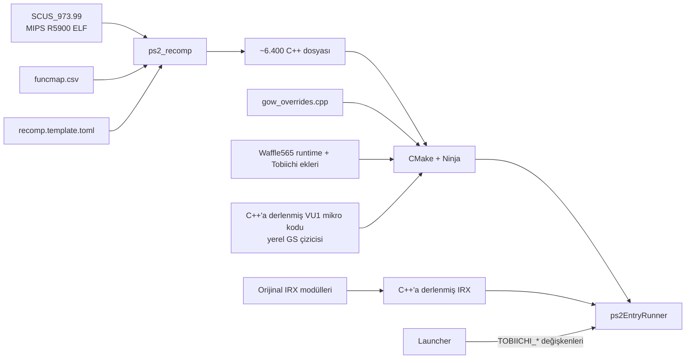

<div align="center">

# God of War — Tobiichi Port

[English](README.md) · **Türkçe** · [Español](README.es.md)

**MIPS R5900 kodunu C++'a statik olarak derleyerek yapılmış, kendi launcher'ı olan *God of War* (PS2, NTSC-U `SCUS-97399`) yerel PC portu.**


</div>

---

> [!IMPORTANT]
> Bu depo **hiçbir oyun dosyası içermez** (ISO, çalıştırılabilir dosya, IRX modülleri, `.PAK` verileri) ve onlardan
> üretilmiş C++ kodunu da içermez. PS2 için **kendi yasal God of War kopyanız** gerekir.

## İçindekiler

- [Bu nedir?](#bu-nedir)
- [Öne çıkanlar](#öne-çıkanlar)
- [Güncel durum](#güncel-durum)
- [Hızlı başlangıç](#hızlı-başlangıç)
- [God Of War: Tobiichi Launcher](#god-of-war-tobiichi-launcher)
- [Depo yapısı](#depo-yapısı)
- [Nasıl çalışır?](#nasıl-çalışır)
- [Belgeler](#belgeler)
- [Emeği geçenler ve lisans](#emeği-geçenler-ve-lisans)

## Bu nedir?

Bu proje PlayStation 2'yi komut komut emüle etmek yerine **oyunun orijinal çalıştırılabilir dosyasını (`SCUS_973.99`)
C++'a çevirir** ([PS2Recomp](https://github.com/ran-j/PS2Recomp) ile) ve yerel bir PC programı olarak derler.
*Ultimate* sürümüyle birlikte [Waffle565'in God-Of-War-Native-Port](https://github.com/Waffle565/God-Of-War-Native-Port)
runtime'ı üzerinde çalışır: GPU'da render-target tabanlı yerel GS çizicisi, oyunun 8 IRX modülü ve VU1 mikrokodu
önceden C++'a derlenmiş, yerel videolar, ses, kol ve hafıza kartı. Tobiichi Port bunun üstüne Linux derlemesini,
başlatıcıyı, Hor+ geniş ekranı ve oynanış eklerini getirir.

Hedef, yerel bir PC oyunu hissi: gerçek zamanlı oyun hızı, akıcı görüntü, doğru grafik ve ses.

## Öne çıkanlar

| | |
|---|---|
| **Başlatıcı** | Ekran kartı, çözünürlük, en-boy oranı, görüntü filtresi, kare hızı sınırı, dosya yolları — hepsi tek yerde |
| **Geniş ekran** | Gerçek Hor+ kamera (16:9, 16:10, 21:9), PCSX2 yamasına dayalı; videolar oyunun kendi geniş ekran sürümlerine geçer ve ekranı doldurur |
| **Yerel çizici** | GPU'da GS render target'ları (OpenGL 4.3+), iç çözünürlük 1×–4× (varsayılan 2×) |
| **Görüntü** | Bilinear (yumuşak) ya da ayarlanabilir keskinlikte bikübik, isteğe bağlı FXAA |
| **Videolar** | Tüm videolar yerel olarak (libmpeg2) gerçek hızda, sesiyle oynar ve oyuna devreder |
| **Yerel IOP ve VU1** | Oyunun IRX modülleri ve VU1 mikrokodu yorumlanmaz, derlenmiş C++ olarak çalışır (oyuna giriş ~20 sn) |
| **Hedef kilitleme** | **Alt** en yakın düşmana kilitlenir, Kratos saldırılarını ona yöneltir; fareyi sağa/sola oynatınca hedef değişir |
| **Çevik dövüş** | Yuvarlanmadan saldırı ve blok %50 yerine %20'de çıkar; kaçan saldırı tuşu kısa süre yeniden denenir |
| **Hile menüsü** | Oyunda **F2**: ölümsüzlük, tek vuruşta öldürme, sınırsız büyü ve Rage of the Gods, maksimum küre, tüm yükseltmeler ve güçler, tüm ekstralar |
| **Orijinal görünüm** | Oyunun kendi PlayStation düğme simgeleri ve HUD'u, değiştirilmeden |

## Güncel durum

| Aşama | Durum |
|---|:---:|
| `SCUS_973.99`'u C++'a çevirme (6.418 dosya) ve Linux'ta yerel derleme | ✅ |
| Açılış, menüler, oynanış, kol ve klavye/fare | ✅ |
| Yerel GS çizicisi, Hor+ geniş ekran, iç çözünürlük 1×–4× | ✅ |
| Sesli, tam ekran videolar | ✅ |
| IOP modülleri ve VU1 yerel kod olarak; ses, kol, hafıza kartı | ✅ |
| Bu sürümün Windows derlemesi | 🔧 Windows kodu Waffle565'inki, burada henüz yeniden derlenmedi |

### Kare hızı hakkında

Oyunun mantığı PS2'nin 60 Hz VBlank'ine bağlıdır; **oyunun kendisi 60 FPS'in üstüne çıkamaz**. Radeon 680M'li bir
dizüstünde (performans güç profili) gemi güvertesi dövüşü 1×'te 50–60, 2×'te 46–47 FPS; sınır VU1 iş parçacığı
(CPU). 3×'te tümleşik GPU dolar: tümleşik grafikte 2× ya da altını kullanın. Başlatıcıdaki FPS sayacı seçeneği
oyun ve pencere hızlarını köşede gösterir.

## Hızlı başlangıç

Kendi `SCUS_973.99` dosyanız, yanında disk modülleri (`*.IRX`) ve orijinal ISO gerekir (ELF'in yanında
`God of War.iso` ya da başlatıcıdan seçin). Tüm derleme adımları: [`docs/ULTIMATE.md`](docs/ULTIMATE.md).

### Linux

```bash
cd PS2Recomp
cmake -S . -B build -G Ninja -DCMAKE_BUILD_TYPE=Release -DPS2X_ENABLE_RUNTIME_LOGS=OFF \
  -DPS2X_ENABLE_AGRESSIVE_LOGS=OFF -DPS2X_ENABLE_IOP_RPC_TRACE=OFF -DPS2X_BUILD_STUDIO=OFF
ninja -C build ps2EntryRunner                              # üretilen kodu yerleştirdikten sonra (docs/ULTIMATE.md)
cd .. && cmake -S launcher -B launcher/build -G Ninja -DCMAKE_BUILD_TYPE=Release
ninja -C launcher/build                                    # başlatıcıyı derle
launcher/build/tobiichi-launcher                           # aç, "Dosyalar"ı kontrol et, OYNA'ya bas
```

Başlatıcı olmadan: `./run_gow.sh`.

### Windows

Windows kod yolu (WGL, XInput titreşim) Waffle565'in runtime'ından değiştirilmeden gelir; bu sürüm henüz Windows'ta
yeniden derlenmedi. Waffle565'in adımları: [`docs/waffle/build-and-run.md`](docs/waffle/build-and-run.md).

## God Of War: Tobiichi Launcher

`launcher/` (Qt 6 Quick, **Türkçe / İngilizce / İspanyolca**) ayarlarınızı kaydeder ve `ps2EntryRunner`'ı ilgili
`TOBIICHI_*` değişkenleriyle başlatır. Ayrıntı: [`docs/LANZADOR.md`](docs/LANZADOR.md) (İspanyolca).

| Sekme | Ayarlar |
|---|---|
| **Grafik** | Ekran kartı, tam ekran/pencere ve çözünürlük, en-boy oranı (4:3, 16:9, 16:10, 21:9 Hor+), yayma, bilinear / bikübik görüntü filtresi, keskinlik, FXAA, çizim çözünürlüğü (1×–4×) |
| **Performans** | Kare hızı sınırı (30 … sınırsız), VSync, ekranda FPS göstergesi |
| **Dosyalar** | Oyun dosyası (CRC ile doğrulanır), ISO, port çalıştırıcısı, hafıza kartı klasörü, otomatik bulma |
| **Kontroller** | Klavye düzeni, ESC davranışı, tuş tablosu |
| **Hileler** | Oyun açılırken etkin hileler (oyun içi **F2** menüsü anında açıp kapatır) |
| **Diğer** | Dil, video atlama, hızlı açılış, kısayollar, son oyun günlüğü, varsayılanlara dön, isteğe bağlı kapak görseli |

`tobiichi-launcher --jugar` oyunu kayıtlı ayarlarla doğrudan başlatır (menü girdisindeki "Hemen oyna" eylemi).
Oyun içinde: **F11** tam ekranı açıp kapatır, **F2** hile menüsünü, **F1** geliştirici panelini açar.

## Depo yapısı

```
.
├── config/                       # Fonksiyon haritası ve derleyici yapılandırması (geniş ekran yaması dahil)
├── docs/                         # Teknik belgeler (İspanyolca) ve durum haritası
├── launcher/                     # God Of War: Tobiichi Launcher (Qt 6)
├── patches/                      # PS2Recomp üzerine, sırayla uygulanan değişiklikler
├── scripts/                      # Derleme, test ve çalıştırma betikleri
├── src/                          # Oyuna özel geçersiz kılmalar
├── tests/                        # Oyundan bağımsız testler
├── tools/                        # VU1 üreticisi, durum haritası, tanılama
├── PS2Recomp/                    # Çalışma zamanı ve derleyici (çalışma ağacı)
└── run_gow.sh                    # Launcher'sız Linux başlatma betiği
```

## Nasıl çalışır?



## Belgeler

- [`docs/ESTADO.md`](docs/ESTADO.md) — araştırma günlüğü: neyin denendiği ve sonucu.
- [`docs/LANZADOR.md`](docs/LANZADOR.md) — launcher, sunum katmanı ve geniş ekran.
- [`docs/RENDIMIENTO.md`](docs/RENDIMIENTO.md), [`docs/RENDERIZADO.md`](docs/RENDERIZADO.md), [`docs/CONTROLES.md`](docs/CONTROLES.md), [`docs/FMV_Y_AUDIO.md`](docs/FMV_Y_AUDIO.md), [`docs/MEMORY_CARD.md`](docs/MEMORY_CARD.md), [`docs/ARQUITECTURA.md`](docs/ARQUITECTURA.md).

Teknik belgeler İspanyolca yazılmıştır. Katkı kuralları: [`AGENTS.md`](AGENTS.md).

## Emeği geçenler ve lisans

- [**PS2Recomp**](https://github.com/ran-j/PS2Recomp) — ran-j ve katkıda bulunanlar: derleyici ve çalışma zamanı (GPL-3.0).
- [**Waffle565'in God-Of-War-Native-Port**](https://github.com/Waffle565/God-Of-War-Native-Port) projesi — Ultimate sürümünün runtime'ı: yerel GS çizicisi, derlenmiş IOP ve VU1, yerel videolar, ses ve hafıza kartı (GPL-3.0).
- [**SotC çalışma zamanı çatalı**](https://github.com/LightVelox/PS2Recomp/tree/ac9efa070638ad3b3accd284de6f898d5ab271d1) — Taylor N. Albarnaz / LightVelox: OpenGL GS arka ucu, komut kuyruğu ve EE düzeltmeleri (GPL-3.0).
- [**KIexster'ın god-of-war-recomp**](https://github.com/KIexster/god-of-war-recomp) — bu portun üzerine kurulduğu God of War derleme hattı ve VU1/VIF yamaları.
- Geniş ekran: nemesis2000 ve CRASHARKI'nin SCUS-97399 için PCSX2 "Widescreen 16:9" yamasına dayanır.
- Launcher: [Cinzel](https://github.com/NDISCOVER/Cinzel) yazı tipi (SIL OFL 1.1, `launcher/recursos/fuentes/OFL.txt`).
- *God of War* © Sony Interactive Entertainment / Santa Monica Studio. Bu proje Sony ile bağlantılı değildir ve onun tarafından onaylanmamıştır. Hiçbir oyun içeriği dağıtılmaz.

Bu depodaki kod, PS2Recomp ile uyumlu olarak **GPL-3.0** lisansıyla yayımlanır. Bkz. [`LICENSE`](LICENSE).
