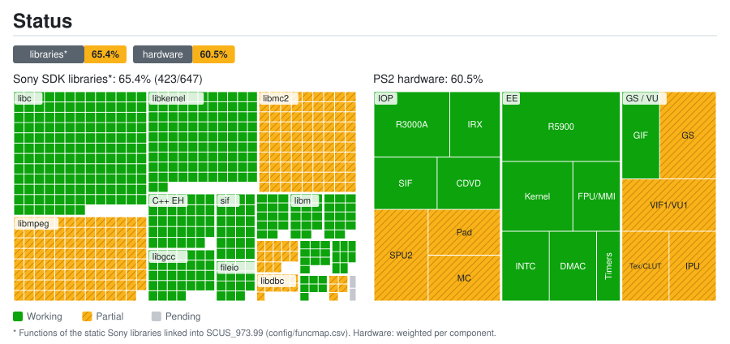
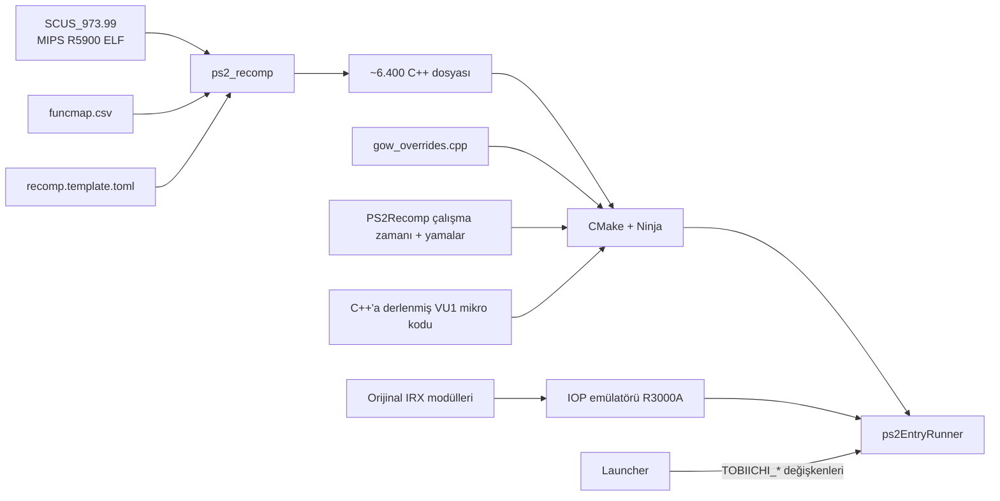

<div align="center">

# God of War — Tobiichi Port

[English](README.md) · **Türkçe** · [Español](README.es.md)

**MIPS R5900 kodunu C++'a statik olarak derleyerek yapılmış, kendi launcher'ı olan *God of War* (PS2, NTSC-U `SCUS-97399`) yerel PC portu.**


</div>

---

> [!IMPORTANT]
> Bu depo **hiçbir oyun dosyası içermez** (ISO, çalıştırılabilir dosya, IRX modülleri, `.PAK` verileri) ve onlardan
> üretilmiş C++ kodunu da içermez. PS2 için **kendi yasal God of War kopyanız** gerekir.

## İçindekiler

- [Bu nedir?](#bu-nedir)
- [Öne çıkanlar](#öne-çıkanlar)
- [Güncel durum](#güncel-durum)
- [Hızlı başlangıç](#hızlı-başlangıç)
- [God Of War: Tobiichi Launcher](#god-of-war-tobiichi-launcher)
- [Depo yapısı](#depo-yapısı)
- [Nasıl çalışır?](#nasıl-çalışır)
- [Belgeler](#belgeler)
- [Emeği geçenler ve lisans](#emeği-geçenler-ve-lisans)

## Bu nedir?

PlayStation 2'yi komut komut taklit etmek yerine bu proje, oyunun orijinal çalıştırılabilir dosyasını
(`SCUS_973.99`) [PS2Recomp](https://github.com/ran-j/PS2Recomp) ile **C++'a çevirir** ve yerel bir PC programı olarak
derler. Program, PS2 donanımını ve işletim sistemini (EE çekirdeği, GS, VU1, DMA, SPU2, CD/DVD…) yeniden uygulayan
bir çalışma zamanına bağlanır. G/Ç işlemcisi (IOP) oyunun **orijinal IRX modüllerini** (ses sürücüsü, veri akıtıcı…)
bir R3000A yorumlayıcısında çalıştırır.

Hedef, yerel hissi veren bir PC portu: gerçek zamanlı oyun hızı, akıcı görüntü, doğru grafik ve ses.

## Öne çıkanlar

| | |
|---|---|
| **Launcher** | Ekran kartı, çözünürlük, geniş ekran, FSR büyütme, FPS sınırı, dosya yolları — hepsi tek yerde |
| **Geniş ekran** | Gerçek Hor+ kamera (16:9, 16:10, 21:9), PCSX2 yamasına dayalı; kapalıyken orijinalle bit bit aynı |
| **İç çözünürlük** | GS 1×–8× çizer (süper örnekleme); varsayılan 2×; GPU 60 FPS'i tutamazsa dinamik çözünürlük bir kademe düşürür. "Net görüntü" PS2'nin satır çiftleme ve titreşim önleme bulanıklığını kaldırır |
| **Büyütme** | Sunum katmanında AMD FSR 1.0 (EASU + RCAS) ve FXAA; görüntü ekrandan büyükse alan ortalamasıyla küçültme |
| **Akıcı pencere** | Pencere, oyunun 60 Hz mantığından bağımsız olarak 120+ FPS'e kadar sunum yapar |
| **Ses** | Ölü bantlı zaman esnetme ve EE zamanına bağlı IOP saati: tempo 1,00'da kalır, looplama yok |
| **Derlenmiş VU1** | Oyunun VU1 mikro kodu yerel koda derlenir; PCSX2 hassasiyetinde hızlı mod (1,5 kat hızlı) ya da bit bit birebir mod |
| **Gerçek zamanlı hız** | VBlank duvar saatini izler: oyun ağır çekime girmek yerine kare atlar |
| **Hedefe kilitlenme** | **Alt** en yakın düşmana kilitlenir, Kratos saldırılarını ona yöneltir; fareyi sağa/sola oynatınca hedef değişir |
| **Çevik dövüş** | Yuvarlanmadan saldırı veya blok %50 yerine %20'de çıkar; kaçırılan saldırı tuşu kısa süre yeniden denenir (ör. L1'i bırakıp aynı karede saldırmak); saldırıyı blok veya kaçınmayla kesmek oyunda zaten vardı |
| **Düğme simgeleri** | Oyundaki düğme simgeleri cihaza göre değişir: atadığınız klavye/fare tuşu, diğer kollarda Xbox düğmeleri (A/B/X/Y, LB/RB/LT/RT), PlayStation kolunda orijinaller; pencere çözünürlüğünde, oyunun menü tarzında çizilir |
| **Hile menüsü** | Oyun içinde **F2**: ölümsüzlük, tek vuruşta öldürme, sınırsız büyü ve Rage of the Gods, maksimum küre, tüm yükseltmeler ve güçler, tüm ekstralar |

## Güncel durum

<a href="docs/estado/detalle.en.md"></a>

Kütüphane ve bileşen bazında ayrıntı: [`docs/estado/detalle.en.md`](docs/estado/detalle.en.md) (İngilizce).

| Aşama | Durum |
|---|:---:|
| `SCUS_973.99`'un C++'a derlenmesi (6.418 dosya) ve yerel derleme | ✅ |
| IOP emülatöründe orijinal IRX modülleri; orijinal ISO'dan veri akışı | ✅ |
| Menüler, zorluk seçimi, oynanış, kol ve klavye/fare | ✅ |
| Görüntü (OpenGL; `fragment_shader_interlock` ile donanım çizici veya hesaplama çizicisi) | ✅ |
| Gerçek zamanlı tempoda ses | ✅ |
| Geniş ekran (Hor+) ve FSR büyütme | ✅ |
| 2×–8× iç çözünürlük ve net görüntü | ✅ |
| FMV: giriş videosu görüntü ve sesle sonuna kadar oynuyor ve oyuna geçiyor; diğer videolar aynı yolu kullanıyor, tek tek denenmedi | 🔧 |
| Hafıza kartı: kaydet/yükle doğrulandı; biçimlendirme doğrulanmadı | 🔧 |
| Performans: hızlı VU1 moduyla oynanışta 60 FPS (gemi test sahnesi RTX 4050'de 30'dan 60'a çıktı) | ✅ |

### Kare hızı hakkında

Oyunun mantığı PS2'nin 60 Hz VBlank'ine kilitlidir; bu yüzden **oyunun kendisi 60 FPS'in üstüne çıkamaz**. VBlank'i
yükseltmek oyunu yalnızca hızlı oynatır. Pencere 120 Hz ve üstünde sunum yapabilir; bu, her yeni kareyi daha erken
gösterir ve gecikmeyi azaltır. Sınır VU1 iş parçacığıdır (işlemci). **Hızlı VU1 modu** (`PS2X_VU1_RAPIDO=ON`, buradaki
varsayılan derleme) bit bit birebir model yerine PCSX2 hassasiyetini kullanır (sıfıra doğru yuvarlayan SSE, DAZ/FTZ,
Z/S bayrakları tembel hesaplanır). Kare başına VU1 süresi 22 ms'den 13 ms'ye, en ağır test sahnesi 30'dan 60 FPS'e
iner; test karesinin görüntüsü piksel piksel aynıdır. `PS2X_VU1_RAPIDO=OFF` birebir modu derler. GS çizicisi için
harici ekran kartı önemlidir (RTX 4050'de kare başına 4–7 ms, Radeon 680M'de 20–26 ms).

**İç çözünürlük:** her örnek konumunun GS VRAM'inin kendi kopyası vardır (paraLLEl-GS yöntemi); okumalar ve paletler
yerel kopyayı kullanır, böylece oyun PS2'dekiyle aynı belleği görür. GPU maliyeti ölçeğin karesiyle artar. RTX 4050
Laptop'ta: 1× 60 FPS, 2× 40–60 FPS, 3× 18–24 FPS. 4× ve üstü çok daha hızlı bir GPU ister. Dinamik çözünürlük (varsayılan açık)
1×'e kadar inerek 60 FPS'i korur; bunun altında sınır GPU'dur. "Net görüntü" tek başına PS2 bulanıklığının çoğunu giderir.

## Hızlı başlangıç

Kendi `SCUS_973.99` dosyanız, yanında disk modülleri (`*.IRX`) ve orijinal ISO gerekir (adı `God of War.iso`, ELF'in
üstündeki klasörde; ya da `GOW_ISO` ile yol verin). Ayrıntılı liste: [`docs/ARQUITECTURA.md`](docs/ARQUITECTURA.md).

### Linux

```bash
cd PS2Recomp
cmake --build build --target ps2EntryRunner -j$(nproc)    # oyun çalıştırıcısını derle
cd .. && cmake -S launcher -B launcher/build -G Ninja -DCMAKE_BUILD_TYPE=Release
ninja -C launcher/build                                    # launcher'ı derle
launcher/build/tobiichi-launcher                           # aç, "Dosyalar"ı kontrol et, OYNA'ya bas
```

Launcher olmadan: `./run_gow.sh`. Sistemin varsayılan GPU'sunu kullanır; `TOBIICHI_GPU=nvidia ./run_gow.sh` harici
NVIDIA kartını zorlar (PRIME offload).

### Windows

```bat
scripts\1_instalar_herramientas.cmd   :: yalnızca ilk seferde (Git ve Build Tools, winget ile)
scripts\2_compilar.cmd                :: ilk seferde 20–40 dk
scripts\3_ejecutar.cmd
```

## God Of War: Tobiichi Launcher

`launcher/` (Qt 6 Quick, **Türkçe / İngilizce / İspanyolca**) ayarlarınızı kaydeder ve `ps2EntryRunner`'ı ilgili
`TOBIICHI_*` değişkenleriyle başlatır. Ayrıntı: [`docs/LANZADOR.md`](docs/LANZADOR.md) (İspanyolca).

| Sekme | Ayarlar |
|---|---|
| **Grafik** | Ekran kartı, tam ekran/pencere ve çözünürlük, en-boy oranı (4:3, 16:9, 16:10, 21:9 Hor+), yayma, FSR / bilinear / piksel büyütme, keskinlik, FXAA, çizim çözünürlüğü (otomatik, 1×–8×), net görüntü |
| **Performans** | Kare hızı sınırı (30 … sınırsız), VSync, ekranda FPS göstergesi |
| **Dosyalar** | Oyun dosyası (CRC ile doğrulanır), ISO, port çalıştırıcısı, hafıza kartı klasörü, otomatik bulma |
| **Kontroller** | Klavye düzeni, ESC davranışı, tuş tablosu |
| **Hileler** | Oyun açılırken etkin hileler (oyun içi **F2** menüsü anında açıp kapatır) |
| **Diğer** | Dil, video atlama, hızlı açılış, kısayollar, son oyun günlüğü, varsayılanlara dön, isteğe bağlı kapak görseli |

`tobiichi-launcher --jugar` oyunu kayıtlı ayarlarla doğrudan başlatır (menü girdisindeki "Hemen oyna" eylemi).
Oyun içinde: **F11** tam ekranı açıp kapatır, **F2** hile menüsünü, **F1** geliştirici panelini açar.

## Depo yapısı

```
.
├── config/                       # Fonksiyon haritası ve derleyici yapılandırması (geniş ekran yaması dahil)
├── docs/                         # Teknik belgeler (İspanyolca) ve durum haritası
├── launcher/                     # God Of War: Tobiichi Launcher (Qt 6)
├── patches/                      # PS2Recomp üzerine, sırayla uygulanan değişiklikler
├── scripts/                      # Derleme, test ve çalıştırma betikleri
├── src/                          # Oyuna özel geçersiz kılmalar
├── tests/                        # Oyundan bağımsız testler
├── tools/                        # VU1 üreticisi, durum haritası, tanılama
├── PS2Recomp/                    # Çalışma zamanı ve derleyici (çalışma ağacı)
└── run_gow.sh                    # Launcher'sız Linux başlatma betiği
```

## Nasıl çalışır?



## Belgeler

- [`docs/ESTADO.md`](docs/ESTADO.md) — araştırma günlüğü: neyin denendiği ve sonucu.
- [`docs/LANZADOR.md`](docs/LANZADOR.md) — launcher, sunum katmanı ve geniş ekran.
- [`docs/RENDIMIENTO.md`](docs/RENDIMIENTO.md), [`docs/RENDERIZADO.md`](docs/RENDERIZADO.md), [`docs/CONTROLES.md`](docs/CONTROLES.md), [`docs/FMV_Y_AUDIO.md`](docs/FMV_Y_AUDIO.md), [`docs/MEMORY_CARD.md`](docs/MEMORY_CARD.md), [`docs/ARQUITECTURA.md`](docs/ARQUITECTURA.md).

Teknik belgeler İspanyolca yazılmıştır. Katkı kuralları: [`AGENTS.md`](AGENTS.md).

## Emeği geçenler ve lisans

- [**PS2Recomp**](https://github.com/ran-j/PS2Recomp) — ran-j ve katkıda bulunanlar: derleyici ve çalışma zamanı (GPL-3.0).
- [**SotC çalışma zamanı çatalı**](https://github.com/LightVelox/PS2Recomp/tree/ac9efa070638ad3b3accd284de6f898d5ab271d1) — Taylor N. Albarnaz / LightVelox: OpenGL GS arka ucu, komut kuyruğu ve EE düzeltmeleri (GPL-3.0).
- [**KIexster'ın god-of-war-recomp**](https://github.com/KIexster/god-of-war-recomp) — bu portun üzerine kurulduğu God of War derleme hattı ve VU1/VIF yamaları.
- Geniş ekran: nemesis2000 ve CRASHARKI'nin SCUS-97399 için PCSX2 "Widescreen 16:9" yamasına dayanır.
- Launcher: [Cinzel](https://github.com/NDISCOVER/Cinzel) yazı tipi (SIL OFL 1.1, `launcher/recursos/fuentes/OFL.txt`); büyütme, AMD FidelityFX Super Resolution 1.0'dan (MIT) uyarlanmıştır.
- *God of War* © Sony Interactive Entertainment / Santa Monica Studio. Bu proje Sony ile bağlantılı değildir ve onun tarafından onaylanmamıştır. Hiçbir oyun içeriği dağıtılmaz.

Bu depodaki kod, PS2Recomp ile uyumlu olarak **GPL-3.0** lisansıyla yayımlanır. Bkz. [`LICENSE`](LICENSE).
